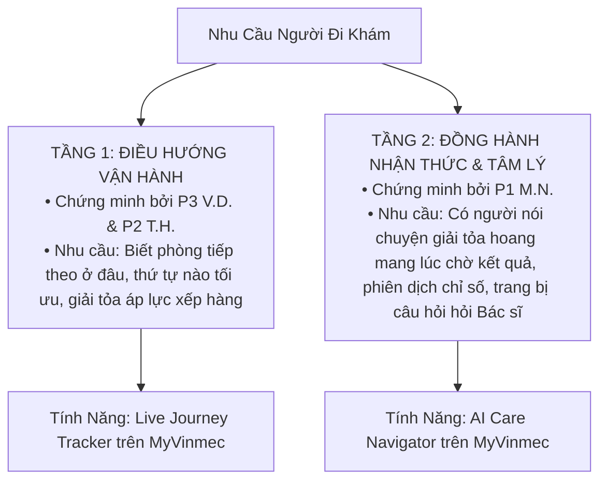

# Nhật Ký Phỏng Vấn Người Dùng & Ghi Chép Nghiên Cứu (User Interview Notes)

> **Ghi chú bảo mật:** Toàn bộ dữ liệu trong tài liệu này đã được ẩn danh theo quy định đạo đức nghiên cứu của VinUni VRIC – Vinmec. Mọi định danh cá nhân được thay thế bằng mã số `P1`, `P2`, `P3`. Không lưu trữ bệnh án, hình ảnh hay chẩn đoán lâm sàng.

---

## 1. Bảng Tổng Hợp Đối Tượng Khảo Sát

| Mã đối tượng | Phân loại người dùng | Kênh / Địa điểm | Ngày thực hiện | Thời lượng | Trạng thái đồng thuận |
| :--- | :--- | :--- | :--- | :--- | :--- |
| **`P1`** *(M.N.)* | Nam, 32t, Cựu quân nhân nghĩa vụ / NV Kho vận, Khám chấn thương khớp gối & Chụp MRI tại bệnh viện lớn | Trực tiếp 1-1 | 19/10/2026 | 38 phút | Đã đồng thuận (Ẩn danh PII theo NĐ 13/2023) |
| **`P2`** *(T.H.)* | Nam, 28t, Sĩ quan Hậu cần Quân chủng Hải quân, Khám định kỳ theo đơn vị tại Viện Y học Hải quân | Điện thoại trực tiếp | 19/10/2026 | 25 phút | Đã đồng thuận (Bằng âm thanh) |
| **`P3`** *(V.D.)* | Nam, 29t, Kỹ sư nhà máy FDI Hàn Quốc tại KCN, Khám sức khỏe bắt buộc theo công ty | Điện thoại trực tiếp | 19/10/2026 | 28 phút | Đã đồng thuận (Bằng âm thanh) |

---

## 2. Ghi Chép Dùng Thử Ứng Dụng MyVinmec Của Ứng Viên (Self-Heuristic Audit)

*Trước khi phỏng vấn người dùng, ứng viên Nguyễn Xuân Tài (K2) trực tiếp tải, đăng ký tài khoản và thực hiện bài kiểm tra khả năng sử dụng (Heuristic Walkthrough) trên ứng dụng MyVinmec thực tế (phiên bản cập nhật tháng 10/2026 trên iOS/Android). Ghi nhận các điểm nghẽn trải nghiệm thực tế như sau:*

### 2.1. Kiểm thử luồng Đặt lịch khám & Tương tác Trợ lý AI (Booking & Conversational Flow)

| Thao tác kiểm thử (Task) | Kỳ vọng của người dùng | Thực tế quan sát được trên app | Phân tích điểm nghẽn kỹ thuật & UX (Friction / Heuristic Violation) |
| :--- | :--- | :--- | :--- |
| **Chọn Chuyên khoa & Bác sĩ** | Chọn chuyên khoa trước, hệ thống tự động lọc ra danh sách bác sĩ có lịch trống phù hợp với ngày mong muốn. | Khi chỉ chọn chuyên khoa mà chưa chọn bác sĩ, hệ thống báo lỗi nhưng **không chỉ rõ nguyên nhân hoặc highlight trường thông tin bắt buộc**. Chỉ khi ấn vào từng bác sĩ cụ thể mới biết bác sĩ đó có trống lịch vào ngày đã chọn hay không (ví dụ: hai bác sĩ nam đầu danh sách đều kín lịch vào Thứ Hai, chuyển sang bác sĩ nữ mới thấy hiển thị bảng khung giờ). | ⚠️ **Vi phạm Heuristic #9 (Help users recognize and recover from errors):** Thông báo lỗi mơ hồ, thiếu chỉ dẫn phục hồi lỗi; người dùng phải thao tác thử-sai (trial and error) để tìm bác sĩ còn lịch. |
| **Chuyển đổi tiêu chí phân loại (Tab Switching)** | Tab "Chuyên khoa", "Bác sĩ" và "Triệu chứng" đóng vai trò là các bộ lọc bổ trợ (Faceted filters) giúp thu hẹp phạm vi tìm kiếm. | Sau khi đã chọn xong Chuyên khoa và Bác sĩ, người dùng chuyển sang tab "Triệu chứng" để bổ sung thông tin thì hệ thống **tự động xóa sạch (State Reset)** toàn bộ các lựa chọn đã thiết lập trước đó. | ⚠️ **Lỗi quản lý trạng thái giao diện (State Loss):** Mental model của người dùng bị phá vỡ; gây mất công sức thao tác và gia tăng cảm giác ức chế khi bị buộc phải chọn lại từ đầu. |
| **Xác nhận Khung giờ khám (Time Slot Selection)** | Chọn khung giờ còn trống (sáng/chiều) và bấm "Đặt lịch" để chuyển sang bước thanh toán/xác nhận thông tin. | Dù đã chọn mốc thời gian hiển thị sẵn trên màn hình (đã chọn dot sáng/chiều), khi bấm "Đặt lịch", hệ thống liên tục xuất thông báo lỗi dạng Toast: *"Thông báo: có lỗi xảy ra. Mời bạn thử lại sau"*. Thao tác thử trên nhiều mốc thời gian khác nhau vẫn gặp lỗi tương tự, dẫn đến không thể hoàn tất giao dịch đặt khám. | ⚠️ **Lỗi ngoại lệ hệ thống không tường minh (Unhandled System Error):** Lỗi kết nối hoặc đồng bộ lịch khám giữa client và backend/HIS không được thông báo rõ nguyên nhân (do mạng, do hết slot, hay lỗi tài khoản), khiến giao dịch bị tắc nghẽn hoàn toàn. |
| **Tương tác với Trợ lý AI tư vấn triệu chứng** | Người dùng mô tả triệu chứng ban đầu để AI gợi ý định hướng chuyên khoa phù hợp nhằm đặt lịch nhanh. | AI liên tục đặt nhiều câu hỏi mở đào sâu vào các triệu chứng phụ khác một cách vòng vo; đặc biệt **giao diện không cung cấp nút "Bỏ qua" (Skip / Escape Hatch)** để người dùng chủ động ngắt đoạn hội thoại và quay lại đặt lịch thủ công. | ⚠️ **Vi phạm Heuristic #3 (User control and freedom):** Bẫy hội thoại không lối thoát (Conversational Lock-in); làm kéo dài thời gian tác vụ không cần thiết khi người dùng đang có nhu cầu đặt khám khẩn trương. |

### 2.2. Kiểm thử luồng Xem Hồ sơ & Kết quả Cận lâm sàng (Results & Post-visit Flow)

| Thao tác kiểm thử (Task) | Kỳ vọng của người dùng | Thực tế quan sát được trên app | Phân tích điểm nghẽn kỹ thuật & UX |
| :--- | :--- | :--- | :--- |
| **Xem bảng kết quả xét nghiệm** | Mở xem kết quả nhanh chóng, có chú giải dễ hiểu để nắm bắt tình trạng sức khỏe ban đầu trước giờ gặp bác sĩ. | Kết quả trả về dưới dạng file scan PDF hoặc bảng dữ liệu phòng lab với nhiều ký hiệu viết tắt kỹ thuật (`SGOT`, `Creatinine`, `HbA1c`), kèm chỉ số bôi đỏ `H`/`L` mà không có lớp diễn giải ngôn ngữ đời thường. | ⚠️ **Rào cản thuật ngữ y khoa & Vùng trũng lo âu:** Người bệnh dễ rơi vào tình trạng hoang mang và tự tra cứu trên mạng, đẩy tâm lý lo lắng lên cao trong thời gian chờ đợi (chủ đề trọng tâm của đề án). |
| **Theo dõi đơn thuốc & Dặn dò** | Dễ dàng xem lại phác đồ, nhắc giờ uống thuốc và đặt hẹn tái khám một chạm trực tiếp từ đơn thuốc. | Đơn thuốc hiển thị dạng văn bản tĩnh; thiếu tích hợp lời dặn dò sinh hoạt cụ thể và chưa có tính năng đồng bộ lịch tái khám vào điện thoại. | ⚠️ **Đứt gãy chăm sóc sau thăm khám:** Người bệnh dễ quên dặn dò của bác sĩ sau khi rời viện. |

---

## 3. Biên Bản Chi Tiết Các Cuộc Phỏng Vấn Người Dùng Trải Nghiệm (P1 – P3)

### 3.1. Cuộc phỏng vấn P1 — Anh M.N. (Nam, 32t, Cựu quân nhân, từng điều trị chấn thương khớp gối & chụp MRI)

* **Bối cảnh & Tiền sử bệnh:** 
  - Từng đi cùng khóa nghĩa vụ quân sự và có thời gian nằm điều trị chấn thương cũ tại cơ sở quân y nơi tác giả từng tham gia công tác (thời điểm đó chỉ uống thuốc giảm đau qua loa chứ chưa giải quyết dứt điểm). Cơn đau âm ỉ kéo dài cho đến khi ra quân.
  - Gần đây đá bóng bị chấn thương nặng ở khớp gối, đau nhức suốt cả tuần, đi lại tập tễnh.
  - Ban đầu tự chữa trị chắp vá: đắp thuốc lá của thầy lang và nghe lời tư vấn các mẹo chữa ngắn hạn quanh địa phương nhưng không đỡ.
  - **Bước ngoặt hành vi (AI-First Discovery):** Người bệnh tự mở AI (ChatGPT/Copilot) ra mô tả triệu chứng. AI phân tích nguy cơ tổn thương cấu trúc khớp sâu (dây chằng/sụn chêm) và khuyến nghị phải đến bệnh viện lớn có máy chụp cộng hưởng từ (MRI). Nhờ đó bệnh nhân mới quyết định đi khám chuyên khoa.
* **Hành vi & Trải nghiệm thực tế tại bệnh viện:**
  - **Khủng hoảng chờ đợi (The Triple Waiting Pain):** Người bệnh chia sẻ điều gây ức chế và mệt mỏi nhất trong cả buổi khám là **chuỗi chờ đợi kéo dài liên hoàn**: chờ lấy phiếu khám, chờ vào phòng chụp MRI, và dài nhất là **chờ cầm kết quả đợi bác sĩ gọi tên vào thông báo**.
  - **Sự cô đơn nhận thức (Cognitive Isolation):** Cầm tờ kết quả và phim MRI trên tay, đọc các thông số kỹ thuật y khoa khô khốc nhưng hoàn toàn không hiểu gì. Cảm giác lo lắng, bất an ập đến dai dẳng.
  - **Sự tiến hóa của hành vi chống chế (Workarounds Evolution):**
    > *"Ngày xưa khi cầm tờ kết quả thì người ta sẽ đi hỏi lan man các bệnh nhân ngồi xung quanh ghế chờ. Phổ cập hơn một chút thì bốc máy gọi điện cho người quen có chuyên môn y tế. Còn hiện tại như anh thì mở ngay điện thoại ra search Google và hỏi AI."*
  - **Nhu cầu tâm lý sâu kín:** Bệnh nhân tiếp tục hỏi AI liên tục ngay trong lúc ngồi chờ bác sĩ gọi:
    > *"Anh cần một người nói chuyện cùng trong lúc chờ đợi để không bị hoang mang. Cảm giác lo lắng ập đến khi đã xét nghiệm xong và dai dẳng trong lúc phải chờ đợi tới lượt gọi vào phòng kết quả."*
  - **Ranh giới an toàn y tế:** Cho đến trước khi bước vào phòng gặp bác sĩ, cả bệnh nhân và AI đều không ai biết chắc chắn là mình bị **đứt dây chằng chéo**. Phải đến sau khi bác sĩ chuyên khoa đối chiếu lâm sàng và đọc phim thì chẩn đoán xác định mới được đưa ra.
* **Điểm gãy khi vào gặp Bác sĩ (Doctor Consultation Breakdown):**
  - Chi trả số tiền lớn để chụp chiếu dịch vụ kỹ thuật cao, nhưng lúc vào phòng khám thì **bác sĩ tư vấn rất ít** (ít hơn nhiều so với những gì AI đã giải thích).
  - Bệnh nhân có rất nhiều nghi vấn, câu hỏi vụn vặt trong đầu nhưng không kịp hỏi hoặc e ngại vì phòng khám đông đúc, bác sĩ bận rộn.
  - **Đứt gãy sau xuất viện:** Đi về nhà rồi vẫn tiếp tục ôm điện thoại hỏi AI về bài tập phục hồi, kiêng cữ vận động và dùng thuốc.

---

### 3.2. Cuộc phỏng vấn P2 — Anh T.H. (Nam, 28t, Sĩ quan Hậu cần Quân chủng Hải quân)

* **Bối cảnh:** Đi khám sức khỏe định kỳ bắt buộc theo lịch sắp đặt của đơn vị tại Viện Y học Hải quân. Khám theo đoàn thể quân y.
* **Hành vi quan sát được:** Thể trạng trẻ khỏe, xem việc đi khám là thủ tục hoàn thành nhiệm vụ theo quy định; không có nhu cầu đào sâu chỉ số cá nhân.
* **Điểm nghẽn cốt lõi (Core Friction):**
  - **Áp lực dòng người & Rào cản e ngại (Patient Hesitancy under Pressure):** 
    > *"Lúc vào phòng muốn hỏi bác sĩ thêm về tình trạng cơ thể thì phòng đông người quá. Người khám sau đứng ngay sát cửa thúc ép cần hoàn thành nhanh để đến lượt họ. Bác sĩ thì mải làm việc nên quên không trả lời hoặc không nghe thấy, thành ra mình ngại nên thôi chẳng hỏi nữa, cầm giấy đi ra luôn."*
* **Ý nghĩa đối với đề án:** Khẳng định tâm lý e ngại hỏi bác sĩ là có thật, xuất phát từ áp lực thời gian của phòng khám. Nếu người bệnh được app trang bị sẵn **2 câu hỏi trọng tâm ngắn gọn trong 30 giây**, họ sẽ vượt qua được rào cản e ngại và bác sĩ cũng dễ dàng giải đáp chớp nhoáng mà không làm trễ ca khám.

---

### 3.3. Cuộc phỏng vấn P3 — Anh V.D. (Nam, 29t, Kỹ sư nhà máy FDI Hàn Quốc tại KCN)

* **Bối cảnh:** Khám sức khỏe định kỳ bắt buộc hàng năm theo chính sách công ty tại cơ sở y tế hợp đồng. Vào và ra rất nhanh theo quy trình công nghiệp.
* **Hành vi quan sát được:** Cầm tờ phiếu giấy khám sức khỏe có in sẵn các chuyên khoa, di chuyển qua lại giữa các phòng khám.
* **Điểm nghẽn cốt lõi (Core Friction):**
  - **Bẫy tuần tự & Mù định hướng không gian (Sequential Trap & Wayfinding Blindness):**
    > *"Khám xong một chỗ thì không biết các phòng tiếp theo ở đâu, đã đi hết các phòng ở tầng 1 chưa hay phải leo lên tầng 2. Cứ nghĩ là phải đi theo đúng thứ tự in trên tờ giấy nên đi lòng vòng tìm kiếm rất mất công. Thường những lúc như vậy đều phải chạy đi tìm y tá đứng ở sảnh để hỏi chỗ xét nghiệm tiếp theo."*
* **Ý nghĩa đối với đề án:** Khẳng định nhu cầu cấp thiết về **Thanh tiến trình điều hướng trạm khám (Live Journey Tracker)** trên ứng dụng: Phải chỉ rõ cho người bệnh biết họ đã hoàn thành bao nhiêu xét nghiệm, bước tiếp theo cần di chuyển đến phòng nào, tầng mấy.

---

## 4. Tổng Kết Dữ Liệu Nghiên Cứu & Đối Chiếu Persona

Hội tụ dữ liệu từ 3 cuộc phỏng vấn thực tế tạo nên **Bản đồ nhu cầu 2 tầng hoàn chỉnh**:

1. **Khám đoàn định kỳ (P2, P3):** Điểm nghẽn nổi cộm là **Quy trình & Điều hướng trạm khám (Wayfinding & Queue Flow)**. Người bệnh không quan tâm sâu chỉ số vì họ coi mình khỏe mạnh.
2. **Khám bệnh lý thực sự (P1):** Điểm nghẽn tột cùng là **Khoảng trống thông tin & Sự cô đơn trong lúc chờ đợi (Information Void & Emotional Isolation)**. Người bệnh cần một người bạn đồng hành giải tỏa hoang mang trong 45–60 phút chờ đợi, và cần được trang bị câu hỏi để tận dụng tối đa thời gian tư vấn ít ỏi của bác sĩ.
3. **Cả hai nhóm đều chứng minh:** Người bệnh rất cần sự hỗ trợ của công nghệ số, và giải pháp **MyVinmec Care Navigator** giải quyết trọn vẹn cả 2 tầng nhu cầu này.

