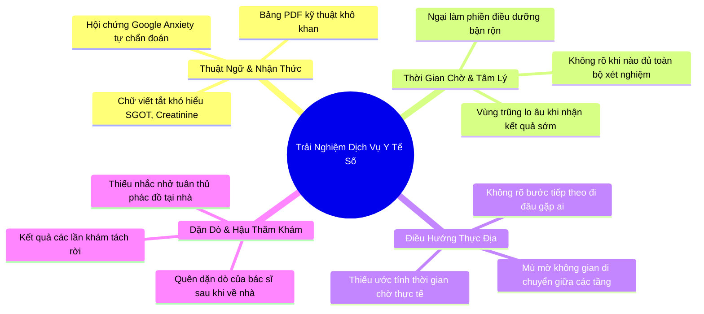

# Tổng Hợp & Phân Tích Insight Người Dùng (User Insights)

> **Phương pháp tổng hợp:** Affinity Mapping (Sơ đồ tương đồng) kết hợp kỹ thuật phân tích theo chiều ngang hành trình dịch vụ (Horizontal Service Journey Synthesis) dựa trên 3 cuộc phỏng vấn ẩn danh (`P1`, `P2`, `P3`) và phiên kiểm thử ứng dụng MyVinmec.

---

## 1. Bản Đồ Tổng Hợp Tương Đồng (Affinity Clusters)

---

## 2. Bốn Cụm Insight Then Chốt (Key Insights)

### Insight 1: Người bệnh không thiếu dữ liệu kết quả, họ thiếu "ngôn ngữ phiên dịch mang tính trấn an"
* **Bằng chứng thực tế:** P1 nhận kết quả PDF trên app có chỉ số đánh dấu `H` (High), lập tức lên Google tìm kiếm và rơi vào trạng thái hoảng loạn vì những bài viết về bệnh hiểm nghèo, dù thực tế đó chỉ là biến thiên sinh lý tạm thời.
* **Bản chất tâm lý:** Người bệnh phổ thông không có nền tảng y khoa. Khi ứng dụng ném ra dữ liệu thô (raw technical data) mà không có ngữ cảnh tham chiếu bình dân (plain-language context), sự mơ hồ thông tin lập tức biến thành nỗi sợ hãi tột độ (Cognitive Overload → Google Panic).
* **Cơ hội:** Cần một công cụ tóm tắt kết quả theo ngôn ngữ đời thường, phân định rõ: *Chỉ số này mang ý nghĩa gì trong đời sống thường ngày* và *Đây có phải tình huống khẩn cấp hay không*.

### Insight 2: Thời gian chờ nhận kết quả là "vùng trũng lo âu" lớn nhất trong hành trình đi khám
* **Bằng chứng thực tế:** Cả P1 và P2 đều nhấn mạnh khoảng thời gian 30–60 phút ngồi chờ ở sảnh bệnh viện sau khi lấy mẫu là lúc họ cảm thấy bất an và căng thẳng nhất.
* **Bản chất tâm lý:** Trong tâm lý học hành vi (Behavioral Psychology), thời gian chờ không xác định (Unexplained Wait) luôn dài hơn và gây ức chế gấp nhiều lần thời gian chờ có giải thích (Explained Wait). Người bệnh ngồi bất động, không biết kết quả của mình đang ở giai đoạn máy chạy mẫu hay bác sĩ duyệt.
* **Cơ hội:** Ứng dụng số cần đóng vai trò là "người đồng hành thời gian thực" cung cấp thanh tiến độ xét nghiệm và những việc người bệnh có thể chuẩn bị sẵn trong lúc chờ.

### Insight 3: Sự đứt gãy giữa thông báo trên màn hình điện thoại và chỉ dẫn hành vi vật lý tại bệnh viện
* **Bằng chứng thực tế:** P2 đưa mẹ lớn tuổi đi khám, khi app báo "Đã có kết quả xét nghiệm máu" thì không rõ cần đưa mẹ lên phòng bác sĩ ngay hay ngồi chờ thêm kết quả nước tiểu.
* **Bản chất tâm lý:** Người chăm sóc (Caregiver) phải gánh chịu tải trọng nhận thức kép: vừa lo an toàn thể chất cho người thân, vừa phải tự tìm đường trong khuôn viên bệnh viện phức tạp.
* **Cơ hội:** Mỗi thông báo kết quả trên app phải luôn đính kèm một Call-to-Action (CTA) hành vi cụ thể: *“Bạn đã hoàn thành 2/3 xét nghiệm. Hãy tiếp tục ngồi tại Sảnh Chờ Tầng 2, hệ thống sẽ tự động gọi số khi đủ kết quả”*.

### Insight 4: "Bác sĩ bận rộn - Bệnh nhân ngập ngừng" tạo nên khoảng trống trao đổi thông tin
* **Bằng chứng thực tế:** P3 chia sẻ rằng bác sĩ khám rất nhanh, giải thích dồn dập. Bệnh nhân vì e ngại hoặc quá tải thông tin nên không kịp đặt câu hỏi đúng, khi về nhà mới nảy sinh hàng loạt thắc mắc.
* **Bản chất tâm lý:** Hội chứng "Áo choàng trắng" (White-coat effect) khiến bệnh nhân rơi vào thế bị động khi đối thoại trực diện với bác sĩ. Họ không biết phải hỏi gì ngoài việc nghe bác sĩ nói.
* **Cơ hội:** Giúp người bệnh soạn sẵn danh sách 2–3 câu hỏi gợi ý thông minh dựa trên kết quả vừa nhận để họ chủ động trao đổi với bác sĩ trong 3 phút thăm khám quý giá.

---

## 3. Lựa Chọn Khoảnh Khắc Vàng (The Moment of Truth)

Từ 4 insight trên, nhóm quyết định hội tụ vào khoảnh khắc then chốt:

> ### 🎯 Khoảnh khắc: Nhận & Đọc hiểu Kết quả Xét nghiệm trên MyVinmec (Pre-consultation Window)

* **Thời điểm:** Ngay khi ứng dụng gửi thông báo "Đã có kết quả xét nghiệm" cho đến khi người bệnh bước vào phòng gặp lại bác sĩ.
* **Tại sao khoảnh khắc này quyết định thành bại của trải nghiệm:**
  1. Đây là đỉnh điểm của sự căng thẳng tâm lý (Peak of Anxiety).
  2. Đây là nơi công nghệ AI phát huy sức mạnh tối đa: chuyển hóa dữ liệu thô thành ngôn ngữ dễ hiểu, chuẩn bị tâm thế cho người bệnh mà **hoàn toàn không can thiệp vào chuyên môn điều trị của bác sĩ**.
  3. Giúp tăng năng suất khám bệnh: Bệnh nhân đã hiểu sơ bộ và có sẵn câu hỏi rõ ràng, giúp bác sĩ tiết kiệm thời gian giải thích các thuật ngữ hành chính cơ bản.

