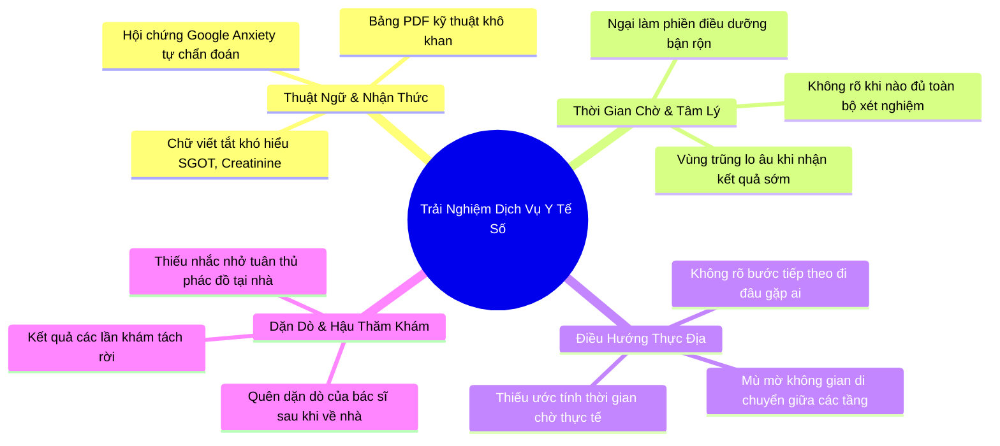

# Tổng Hợp & Phân Tích Insight Người Dùng (User Insights)

> **Phương pháp tổng hợp:** Affinity Mapping (Sơ đồ tương đồng) kết hợp kỹ thuật phân tích theo chiều ngang hành trình dịch vụ (Horizontal Service Journey Synthesis) dựa trên 3 cuộc phỏng vấn ẩn danh (`P1`, `P2`, `P3`) và phiên kiểm thử ứng dụng MyVinmec.

---

## 1. Bản Đồ Tổng Hợp Tương Đồng (Affinity Clusters)

---

## 2. Bốn Cụm Insight Then Chốt (Key Insights)

### Insight 1: Người bệnh ĐÃ VÀ ĐANG dùng AI để khỏa lấp sự cô đơn trong Khoảng trống thông tin (Information Void)
* **Bằng chứng thực tế (P1 — M.N.):** Sau khi chụp MRI khớp gối, P1 ngồi chờ 45 phút ở sảnh trong sự bất an dai dẳng. Cầm bản kết quả và phim chụp nhưng không hiểu gì, P1 liên tục mở AI ra hỏi vì: *"Anh cần một người nói chuyện cùng trong lúc chờ đợi để không bị hoang mang"*. Trước đó, chính AI là công cụ định hướng P1 đi chụp MRI sau khi chữa mẹo/đắp thuốc lang không khỏi.
* **Tiến hóa hành vi đối phó (Workarounds Evolution):**
  1. *Thế hệ 1:* Hỏi lan man người bệnh xung quanh ghế chờ (dễ lây lan thông tin sai lệch).
  2. *Thế hệ 2:* Bốc máy gọi người quen có chuyên môn y tế (gây phiền hà, người quen không có hồ sơ bệnh án).
  3. *Thế hệ 3:* Tự tra Google và hỏi AI ngoài luồng (ChatGPT, Copilot...).
* **Bản chất tâm lý & Y khoa:** 
  * Đây là hội chứng **"Scanxiety"** phối hợp với sự **Cô đơn nhận thức (Cognitive Isolation)**. Người bệnh không chỉ cần dữ liệu, họ cần một **"Người bạn đồng hành xoa dịu tâm lý"**.
  * Dùng AI tự do bên ngoài có rủi ro lớn vì thiếu rào chắn y khoa (Guardrails). Tuy nhiên, cho đến trước khi bác sĩ chẩn đoán, không ai (kể cả bệnh nhân và AI) khẳng định đứt dây chằng chéo. Điều này chứng minh: **AI chỉ đóng vai trò xoa dịu và định hướng, quyền chẩn đoán xác định phải thuộc về Bác sĩ**.
* **Cơ hội:** MyVinmec cần cung cấp một **Care Navigator chính thống, an toàn, có Guardrail** để bảo vệ người bệnh thay vì để họ tự dùng AI ngoài luồng.

### Insight 2: Chuỗi chờ đợi liên hoàn (Triple Waiting Pain) bào mòn kiên nhẫn của người bệnh
* **Bằng chứng thực tế (P1, P2):** Điểm khó chịu cực đoan nhất trong cả buổi khám không phải là lúc lấy mẫu, mà là **chuỗi 3 lần chờ đợi vô định**:
  1. Chờ lấy số thứ tự / check-in.
  2. Chờ vào phòng chụp chiếu / lấy mẫu xét nghiệm.
  3. **Chờ bác sĩ gọi tên đọc kết quả (Đỉnh điểm lo âu & bất an - Peak Anxiety).**
* **Bản chất tâm lý:** Thời gian chờ không giải thích (Unexplained Wait) gây ức chế tâm lý gấp bội. Ngồi 45 phút cầm kết quả mà không biết khi nào đến lượt mình gọi vào phòng khiến cảm giác lo lắng ập đến và kéo dài dai dẳng.
* **Cơ hội:** Ứng dụng số cần cung cấp thanh tiến độ thời gian thực (Live Journey Tracker) ước lượng số phút và trạng thái xử lý mẫu để xua tan cảm giác bất định.

### Insight 3: "Bẫy tuần tự" & Mù định hướng trạm khám (Sequential Trap & Wayfinding Blindness)
* **Bằng chứng thực tế (P3 — V.D.):** Đi khám định kỳ, cầm tờ phiếu giấy có in sẵn các chuyên khoa, người bệnh tưởng rằng bắt buộc phải đi theo thứ tự in trên giấy nên đi lòng vòng tìm kiếm khắp tầng 1, tầng 2, liên tục phải đi tìm y tá hỏi đường.
* **Bản chất vận hành:** Người bệnh phổ thông thiếu tư duy hệ thống về luồng khám. Họ không biết phòng nào có thể khám trước để tối ưu thời gian.
* **Cơ hội:** Ứng dụng MyVinmec cần hiển thị rõ lộ trình trạm khám thông minh: *“Bạn đã xong 2/3 bước. Hãy đến Phòng 302 Tầng 3 để tiếp tục”*.

### Insight 4: Nghịch lý "Chi trả dịch vụ cao nhưng thời gian tư vấn ít ỏi" & Rào cản e ngại hỏi Bác sĩ
* **Bằng chứng thực tế (P1, P2):**
  * *P1:* Chi trả số tiền lớn để chụp chiếu kỹ thuật cao, nhưng khi vào phòng thì **bác sĩ tư vấn rất ít** (ít hơn nhiều so với những gì AI đã giải thích). Người bệnh có nhiều câu hỏi nghi vấn vụn vặt nhưng không kịp hỏi, đi về nhà rồi vẫn tiếp tục ôm điện thoại hỏi AI.
  * *P2:* Muốn hỏi bác sĩ nhưng phòng khám quá đông, người sau đứng sát cửa thúc ép, bác sĩ bận rộn nên **ngại không dám hỏi, cầm giấy đi ra luôn**.
* **Bản chất tương tác:**
  * Bác sĩ chịu áp lực luân chuyển ca khám (**Patient Throughput**) nên không thể ngồi giải thích từng chi tiết vụn vặt.
  * Bệnh nhân chịu tâm lý e ngại (**Patient Hesitancy**) và không biết cách gom câu hỏi trọng tâm.
* **Cơ hội:** Trợ lý Care Navigator giúp người bệnh chắt lọc sẵn đúng **2 câu hỏi trọng tâm** để hỏi bác sĩ trong 30 giây, giúp giải quyết triệt để sự dở dang thông tin.

---

## 3. Lựa Chọn Khoảnh Khắc Vàng (The Moment of Truth)

Từ 4 insight trên, nhóm quyết định hội tụ vào khoảnh khắc then chốt:

> ### 🎯 Khoảnh khắc: Khoảng Trống Thông Tin Khi Chờ Kết Quả Xét Nghiệm (Pre-consultation Information Void)

* **Thời điểm:** Ngay khi ứng dụng gửi thông báo "Đã có kết quả xét nghiệm" cho đến khi người bệnh bước vào phòng gặp lại bác sĩ.
* **Tại sao khoảnh khắc này mang lại giá trị đột phá cao nhất (Tam Giác Giá Trị):**
  1. **Cho Người Bệnh:** Hóa giải hội chứng *Scanxiety*, chặn đứng tâm lý *Catastrophizing* & *Cyberchondria*, chuyển trạng thái từ sợ hãi tột cùng sang tự tin hiểu biết.
  2. **Cho Bác Sĩ:** Tiết kiệm 7–10 phút dọn dẹp hiểu lầm mỗi ca khám, giảm thiểu nguy cơ sai lệch sinh hiệu do stress, tránh kiệt sức (*Doctor Burnout*).
  3. **Cho Bệnh Viện Vinmec:** Tăng tốc độ luân chuyển bệnh nhân (*Patient Throughput*), bảo toàn trọn vẹn cảm giác được chăm sóc (*Care Continuity*) và khẳng định vị thế y tế số nhân văn hàng đầu.

