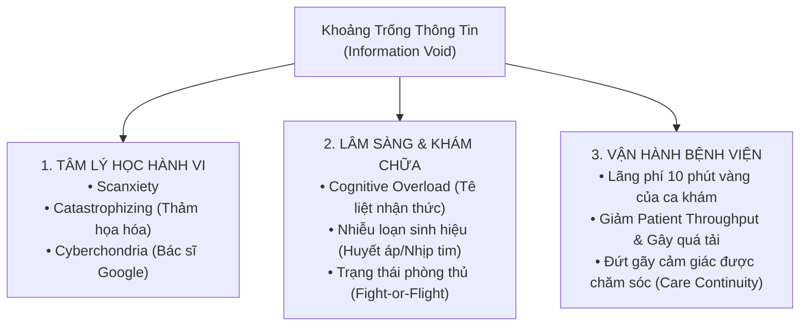

# Phân Tích & Ưu Tiên Điểm Đau Cốt Lõi (Pain Points Analysis)

> **Mục tiêu:** Sàng lọc và định lượng các điểm đau phát hiện trong hành trình đi khám để chọn ra đúng **MỘT điểm đau có tác động lớn nhất và khả thi nhất** để giải quyết trong khuôn khổ Exploration Sprint.

---

## 1. Ma Trận Đánh Giá & Ưu Tiên Điểm Đau (Prioritization Matrix)

| Mã | Điểm đau được nhận diện | Tần suất xuất hiện (Frequency) | Mức độ nghiêm trọng tâm lý (Severity) | Khả năng giải quyết bằng AI (Feasibility) | Mức độ ưu tiên tổng thể (Priority) |
| :--- | :--- | :--- | :--- | :--- | :--- |
| **P-01** | **Bảng kết quả cận lâm sàng trên MyVinmec chứa nhiều thuật ngữ viết tắt và ký hiệu kỹ thuật khô khan, khiến người bệnh tự tra cứu Google và rơi vào hoảng loạn tâm lý trước giờ gặp bác sĩ.** | **Rất cao (3/3 người phỏng vấn đều gặp)** | **Rất nghiêm trọng (Gây lo âu tột độ, mất niềm tin vào kết quả)** | **Rất cao (LLM xuất sắc trong việc chuyển đổi thuật ngữ chuyên môn sang ngôn ngữ bình dân có kiểm chứng)** | ⭐⭐⭐⭐⭐ **ƯU TIÊN SỐ 1 (Chọn giải quyết)** |
| **P-02** | Người bệnh không nắm được thời gian dự kiến trả kết quả (ước tính còn bao nhiêu phút), gây cảm giác sốt ruột và không dám rời sảnh chờ để nghỉ ngơi. | Cao (2/3 người) | Trung bình (Khó chịu về mặt vận hành, tốn thời gian) | Trung bình (Cần tích hợp sâu vào hệ thống LIS/HIS nội bộ để lấy dữ liệu hàng đợi máy xét nghiệm) | ⭐⭐⭐ (Xếp hàng sau) |
| **P-03** | Thiếu chỉ dẫn hành vi không gian: Sau khi có kết quả, người bệnh không rõ đã đủ hết mẫu chưa và phải di chuyển tiếp về phòng nào để gặp bác sĩ. | Trung bình (1/3 người) | Trung bình (Làm chậm luồng di chuyển của bệnh nhân tại hành lang) | Thấp (Vấn đề này giải quyết bằng Wayfinding UI / SMS định hướng quy trình, không nhất thiết dùng AI) | ⭐⭐ (Không ưu tiên) |
| **P-04** | Người bệnh quên lời dặn dò của bác sĩ sau khi rời viện; không theo dõi được xu hướng biến thiên của các chỉ số qua các lần khám định kỳ. | Cao (2/3 người) | Đáng kể (Ảnh hưởng đến tuân thủ phác đồ dài hạn) | Cao (Personalized Health Agent), nhưng phạm vi quá rộng cho sprint 6 tuần ban đầu. | ⭐⭐⭐⭐ (Định hướng giai đoạn 2) |

---

## 2. Bản Chất Của "Khủng Hoảng Chờ Đợi" (Information Void) & Tam Giác Tác Động

Khoảnh khắc bệnh nhân nhận kết quả xét nghiệm/hình ảnh trên ứng dụng MyVinmec nhưng chưa đến lượt vào phòng gặp bác sĩ được gọi là **"Khoảng trống thông tin" (Information Void)**. Đây là một "khủng hoảng chờ đợi" mang tính hệ thống cần được can thiệp khẩn cấp dưới 3 lăng kính chuyên ngành:

### 2.1. Góc độ Tâm lý học hành vi (Psychological Impact)
* **Thuật ngữ chuyên ngành quốc tế — "Scanxiety":** Trong y khoa thế giới, nỗi sợ hãi tột cùng trong lúc chờ đợi kết quả chụp chiếu/xét nghiệm được định danh chính thức là *"Scanxiety"* (ghép giữa *Scan* và *Anxiety*).
* **Con dao hai lưỡi của số hóa:** Khi MyVinmec minh bạch hóa dữ liệu bằng cách trả kết quả thẳng về điện thoại, người bệnh nhìn thấy các chỉ số màu đỏ (vượt ngưỡng) hoặc thuật ngữ kỹ thuật phức tạp (`ECHO hỗn hợp`, `tăng men gan`, `thâm nhiễm`) mà không có người giải thích, kích hoạt ngay 2 phản ứng tâm lý tiêu cực:
  * **Mất kiểm soát cảm xúc & Thảm họa hóa (Catastrophizing):** Người bệnh tự động phóng đại mức độ nghiêm trọng của một chỉ số nhỏ thành bệnh hiểm nghèo/ung thư, gây triệu chứng thực thể tức thì (tim đập nhanh, vã mồ hôi, buồn nôn).
  * **Hội chứng "Bác sĩ Google" & Cyberchondria:** Theo thống kê y tế quốc tế, hơn 80% người bệnh đối diện khoảng trống thông tin sẽ copy thuật ngữ lên Google. Việc đọc các kịch bản tồi tệ nhất sinh ra **Cyberchondria** (hội chứng lo âu bệnh lý do tự chẩn đoán sai trên internet), biến sự chờ đợi mệt mỏi thành cơn hoảng loạn tột độ.

### 2.2. Góc độ Lâm sàng & Chất lượng khám chữa bệnh (Clinical Impact)
Khủng hoảng tâm lý không chỉ ảnh hưởng người bệnh mà trực tiếp kéo lùi chất lượng chuyên môn của ca khám:
* **Tê liệt nhận thức (Cognitive Overload):** Khi bước vào phòng khám trong trạng thái "Cyberchondria", bộ não người bệnh rơi vào cơ chế phòng thủ (*Fight-or-Flight*). Họ tê liệt khả năng lắng nghe khách quan, khó tiếp thu phác đồ phức tạp, hoặc liên tục ngắt lời bác sĩ bằng các thông tin rác vừa đọc trên mạng.
* **Nhiễu loạn sinh hiệu lâm sàng:** Lo âu kích thích hệ giao cảm làm tăng nhịp tim và huyết áp thực tế (tương tự *Hội chứng áo choàng trắng - White-Coat Syndrome*), dễ khiến bác sĩ đánh giá sai lệch các chỉ số sinh hiệu đo tại chỗ.

### 2.3. Góc độ Vận hành & Trải nghiệm Dịch vụ (Operational & Experience Impact)
Tại hệ thống y tế tư nhân cao cấp như Vinmec, trải nghiệm dịch vụ bị định hình mạnh mẽ nhất ở các điểm nghẽn:
* **Lãng phí "10 phút vàng" của bác sĩ:** Thay vì dành trọn vẹn 15 phút quý giá để đào sâu phác đồ và giải pháp điều trị, bác sĩ phải mất 7–10 phút đầu tiên chỉ để "dọn dẹp" hiểu lầm, xoa dịu hoảng loạn và đính chính các suy diễn sai lệch. Điều này làm giảm luân chuyển bệnh nhân (*Patient Throughput*), gây trễ giờ dây chuyền và đẩy bác sĩ vào tình trạng kiệt sức (*Doctor Burnout*).
* **Đứt gãy cảm giác được chăm sóc (Care Continuity):** Dù ứng dụng có hiện đại đến đâu, việc quăng cho người bệnh một tệp PDF thông số lạnh lẽo và để họ tự bơi trong sợ hãi chính là sự đứt gãy trải nghiệm chữa lành, tạo cảm giác bị bỏ rơi (*Cognitive Abandonment*) tại điểm chạm nhạy cảm nhất.

---

## 3. Phân Tích Nguyên Nhân Gốc Rễ (5 Whys Analysis) cho Điểm Đau P-01

* **Vấn đề bề mặt:** *Người bệnh cảm thấy cực kỳ hoang mang, sợ hãi khi mở file kết quả xét nghiệm trên ứng dụng MyVinmec.*
  * **Tại sao 1?** Vì trên app hiển thị các bảng chỉ số với nhiều thuật ngữ viết tắt tiếng Anh và các ký hiệu `H` (High), `L` (Low) bôi đỏ mà không có giải thích ý nghĩa.
  * **Tại sao 2?** Vì hệ thống phần mềm bệnh viện hiện tại xuất kết quả trực tiếp từ hệ thống xét nghiệm phòng lab (LIS) dưới dạng biểu mẫu kỹ thuật chuẩn y khoa vốn chỉ thiết kế cho nhân viên y tế đọc.
  * **Tại sao 3?** Vì trước đây bệnh viện xem kết quả là tài liệu bàn giao sau cùng của bác sĩ, chưa tính đến kịch bản bệnh nhân tự cầm điện thoại đọc kết quả trước khi gặp bác sĩ 30–60 phút.
  * **Tại sao 4?** Vì chưa có một "lớp phiên dịch thông tin" (Information Translation Layer) tự động đứng giữa hồ sơ y tế thô và giao diện người dùng để diễn giải ngôn ngữ đời thường an toàn.
  * **Tại sao 5 (Root Cause)?** Bệnh viện chuyển đổi số khâu trả kết quả từ giấy sang app (Digitalization), nhưng **chưa chuyển đổi số trải nghiệm nhận thức của người bệnh (Human-centered Experience)**. Người bệnh được trao dữ liệu nhưng bị bỏ rơi trong sự cô độc nhận thức (Cognitive Isolation).

---

## 4. Quyết Định Lựa Chọn & Phạm Vi Giải Pháp (Scoping Decision)

* **Điểm đau được chọn chính thức:** **P-01 — Khủng hoảng chờ đợi (Information Void & Scanxiety) khi đọc kết quả cận lâm sàng trên MyVinmec.**
* **Định vị giải pháp (Core Role):** Không chẩn đoán thay bác sĩ, mà đóng vai trò là **"Bước đệm giảm xóc tâm lý" (Psychological Shock-absorber)** và **"Lớp phiên dịch thông tin y tế phi lâm sàng"**.
* **Ranh giới giải quyết (Boundary & Constraints):**
  * **Giải quyết cái gì:** Dọn dẹp tâm trí người bệnh khỏi sự hoảng loạn vô nghĩa (Cyberchondria), giải thích ý nghĩa phổ thông của chỉ số, phân loại mức độ bình thường/bất thường một cách chừng mực, và trang bị sẵn 2–3 câu hỏi trọng tâm để tối ưu hóa buổi tư vấn lâm sàng với bác sĩ.
  * **TUYỆT ĐỐI KHÔNG LÀM GÌ:** Không đưa ra chẩn đoán ("Anh bị bệnh X rồi"), không kê đơn, không kết luận vô hại đối với các triệu chứng báo động đỏ (Red Flags).
* **Đầu vào chuyển tiếp:** Điểm đau P-01 được chuẩn hóa thành **Need Statement theo chuẩn Stanford Biodesign** tại thư mục `03-need-statement/`.
