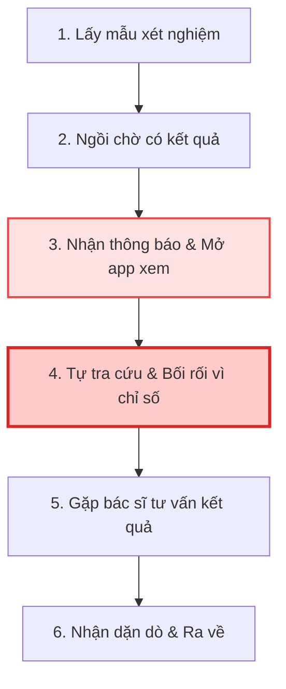

# Bản Đồ Hành Trình Trải Nghiệm Người Bệnh (Workflow Journey Map)

> **Phạm vi khảo sát:** Khoảnh khắc từ khi người bệnh hoàn thành lấy mẫu xét nghiệm → nhận kết quả trên MyVinmec → quay lại phòng bác sĩ nghe tư vấn → nhận dặn dò và ra về.  
> **Chân dung đại diện (Persona):** Người bệnh ngoại trú / Người chăm sóc sử dụng ứng dụng MyVinmec kết hợp thăm khám trực tiếp tại viện.

---

## 1. Sơ Đồ Luồng Tổng Thể (Workflow Overview)

---

## 2. Bảng Ma Trận Hành Trình (Journey Map Matrix)

| Giai đoạn (Stages) | 1. Lấy mẫu & Rời phòng thủ thuật | 2. Chờ kết quả tại sảnh / khuôn viên | 3. Nhận thông báo kết quả trên MyVinmec | 4. Đọc hiểu kết quả & Chờ gặp Bác sĩ | 5. Vào phòng Bác sĩ nghe kết luận | 6. Nhận dặn dò & Rời viện |
| :--- | :--- | :--- | :--- | :--- | :--- | :--- |
| **Hành động của người bệnh (Patient Actions)** | Lấy máu/nước tiểu, nghe điều dưỡng dặn "chờ 45–60 phút có kết quả", rời phòng. | Ngồi ở sảnh chờ, đi ăn nhẹ hoặc uống cafe; liên tục kiểm tra điện thoại xem có thông báo chưa. | Điện thoại rung thông báo từ MyVinmec. Bấm vào app, tải và mở file kết quả. | Lướt xem các trang bảng số liệu, thấy các dòng bôi đỏ hoặc chữ viết tắt (`H`, `L`). Tìm kiếm Google. | Nghe bác sĩ đọc kết quả, nghe giải thích phác đồ điều trị và dặn dò sinh hoạt. | Đến quầy thanh toán viện phí/lấy thuốc, nhận đơn thuốc trên app, di chuyển ra về. |
| **Điểm chạm (Touchpoints)** | Điều dưỡng, Bàn lấy mẫu, Phiếu hẹn giấy. | Màn hình LED gọi số ở sảnh, Loa thông báo, Ghế chờ. | Push notification MyVinmec, Màn hình thông báo app. | Màn hình PDF/Bảng kết quả trên MyVinmec, Trình duyệt Google tìm kiếm. | Bác sĩ, Bàn khám, Màn hình máy tính phòng khám. | Nhân viên quầy thuốc, Bản in đơn thuốc, Mục 'Đơn thuốc' trên MyVinmec. |
| **Cảm xúc người bệnh (Emotion Curve)** | 😐 **Bình thường / Hơi mệt mỏi** ("Xong thủ thuật rồi, giờ ngồi chờ"). | 😟 **Sốt ruột & Hồi hộp** ("Không biết bao giờ mới xong, còn nhiều người trước mình không?"). | 😲 **Tò mò & Lo lắng** ("App báo có rồi, không biết sức khỏe mình thế nào?"). | 😫 **Hoang mang & Căng thẳng tột độ** (Peak Frustration) ("Chỉ số này bôi đỏ nghĩa là sao? Có phải bệnh hiểm nghèo không?"). | 😌 **Nhẹ nhõm nhưng Vội vã** ("May quá bác sĩ bảo không sao, nhưng bác nói nhanh quá chưa kịp hỏi hết"). | 😐 **Hụt hẫng & Mơ hồ** ("Về nhà uống thuốc thế nào, tái khám ngày nào app có nhắc không?"). |
| **Điểm đau cốt lõi (Core Pain Points)** | Không rõ lộ trình: sau khi lấy mẫu có cần nhịn ăn uống tiếp hay không. | Thời gian chờ mù mờ: không có thanh tiến độ ước tính còn bao lâu xong mẫu. | Kết quả trả về định dạng kỹ thuật số khô khan; toàn chữ viết tắt chuyên ngành. | Hiện tượng "Google Anxiety": tra cứu bừa bãi trên mạng dẫn đến hoang mang sai lệch trước giờ gặp bác sĩ. | Thời gian tư vấn có hạn (3–5 phút); người bệnh không biết đặt câu hỏi trọng tâm. | Dặn dò của bác sĩ không được lưu trữ thành các đầu việc (Action Items) cụ thể trên app. |
| **Cơ hội cải tiến (Opportunities)** | Hướng dẫn dinh dưỡng tức thì sau lấy mẫu trực tiếp trên app. | Cung cấp Live Progress Bar ước lượng thời gian trả kết quả theo chuẩn vận hành viện. | Bổ sung lớp tóm tắt ngôn ngữ bình dân (Plain English / Vietnamese) ngay trên giao diện kết quả. | Trợ lý số chuẩn bị sẵn 2–3 câu hỏi trọng tâm người bệnh nên hỏi bác sĩ; trấn an tâm lý. | Cung cấp bản tóm tắt đối thoại khám hoặc phiếu ghi chú điện tử một chạm. | Tự động đồng bộ lịch tái khám vào Google Calendar / Apple Calendar kèm nhắc uống thuốc. |
| **Tiềm năng ứng dụng AI (AI Potential)** | 🟢 **Thấp (Rule-based)**: Chỉ cần pop-up quy định mẫu. | 🟡 **Trung bình**: Dự báo thời gian chờ dựa trên hàng đợi (Queue ML). | 🔴 **CỰC KỲ CAO (Generative AI)**: Chuyển đổi bảng kết quả thô sang giải thích ngôn ngữ dễ hiểu. | 🔴 **CỰC KỲ CAO (Generative AI)**: Gợi ý câu hỏi thông minh, phát hiện dấu hiệu khẩn cấp để định hướng an toàn. | 🟡 **Trung bình**: Hỗ trợ bác sĩ ghi chép âm thanh sang văn bản (Ambient Clinical Scribe). | 🟢 **Thấp (Automation)**: Nhắc việc định kỳ qua Notification. |

---

## 3. Xác Định Điểm Gãy Trải Nghiệm Lớn Nhất

Nhìn vào đường cong cảm xúc (Emotion Curve), **Giai đoạn 3 và 4 (Nhận thông báo → Đọc kết quả → Chờ gặp Bác sĩ)** là điểm rơi tự do của chỉ số hài lòng:
* Cảm xúc tụt xuống mức tiêu cực nhất (↓ -2 trên thang Likert 5 điểm).
* Nguyên nhân gốc: Bệnh nhân nhận được thông tin nhưng **bị tước đi ngữ cảnh hiểu biết** (Context-less Information).
* Đây chính là trọng tâm mà giải pháp prototype cần giải quyết triệt để.

