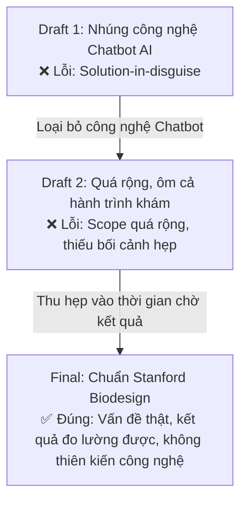

# Tuyên Bố Nhu Cầu Chuẩn Stanford Biodesign (Need Statement)

> **Phương pháp luận:** Stanford Biodesign Need Statement Framework.  
> **🚨 QUY TẮC BẮT BUỘC:** Tuyệt đối **KHÔNG ĐƯỢC ĐƯA GIẢI PHÁP CÔNG NGHỆ** (như AI, Chatbot, LLM, App feature, Automation) vào trong câu tuyên bố nhu cầu. Need Statement chỉ mô tả *Vấn đề*, *Đối tượng*, *Kết quả mong muốn* và *Bối cảnh*.

---

## 1. Công Thức Chuẩn Stanford Biodesign

> **A way to [Outcome / Kết quả] for [Population / Đối tượng] who [Problem / Vấn đề] in [Context / Bối cảnh]**

---

## 2. Tuyên Bố Nhu Cầu Chính Thức (Final Need Statement)

> ### 🎯 Tuyên bố chính thức:
> **"Một cách để giảm thiểu mức độ hoang mang lo âu và nâng cao khả năng chủ động hiểu biết về tình trạng sức khỏe cho người bệnh ngoại trú đang gặp khó khăn trong việc đọc hiểu các chỉ số kỹ thuật trên bảng kết quả cận lâm sàng trong khoảng thời gian chờ tư vấn trực tiếp với bác sĩ tại bệnh viện."**

---

## 3. Bảng Phân Tách 4 Thành Tố Cốt Lõi

| Thành tố (Component) | Chi tiết xác định trong nghiên cứu | Bằng chứng kiểm chứng từ Bước 01 & 02 |
| :--- | :--- | :--- |
| **Outcome (Kết quả mong muốn đo lường được)** | **Hóa giải hội chứng "Scanxiety"**, ngăn chặn tâm lý suy diễn thảm họa (*Catastrophizing*) & lo âu tra mạng (*Cyberchondria*); **giải phóng người bệnh khỏi tê liệt nhận thức (*Cognitive Overload*)** và nâng cao khả năng chủ động chuẩn bị câu hỏi trọng tâm trao đổi với bác sĩ. | Người phỏng vấn P1, P2 khẳng định nếu có thông tin giải thích trước, mức độ căng thẳng giảm từ thang 9/10 xuống mức bình tĩnh 3/10; bác sĩ tiết kiệm thời gian giải thích lan man. |
| **Population (Nhóm người dùng mục tiêu)** | **Người bệnh ngoại trú và người chăm sóc gia đình (Caregivers)** sử dụng ứng dụng di động bệnh viện. | Đối tượng P1 (người trẻ khám tổng quát), P2 (người chăm sóc người cao tuổi). |
| **Problem (Vấn đề / Điểm đau cụ thể)** | **Rơi vào "Khoảng trống thông tin" (Information Void)**, bối rối và hoảng loạn khi tự đọc các chỉ số kỹ thuật/ký hiệu cảnh báo đỏ `H`/`L`, dẫn đến hiện tượng tra cứu Google bừa bãi và ngộ nhận bệnh hiểm nghèo. | Ghi chép phỏng vấn P1: hoang mang suốt 45 phút vì tưởng nhầm chỉ số men gan nhẹ thành ung thư/suy gan. |
| **Context (Bối cảnh thực tế)** | **Trong khoảng thời gian chờ (30–60 phút)** từ khi nhận kết quả trên thiết bị cá nhân đến khi bước vào phòng gặp bác sĩ tại khuôn viên bệnh viện. | Khoảng trống thời gian tại sảnh chờ/quán cafe, nơi bác sĩ không thể túc trực giải thích tức thì. |

---

### 3.1. Cơ Sở Lý Luận & Bằng Chứng Nghiên Cứu Bàn (Desk Research Rationale)

Việc chuẩn hóa câu Tuyên bố nhu cầu (Need Statement) trên được bảo vệ bởi **3 góc độ nghiên cứu y văn và vận hành y tế quốc tế**:

1. **Góc độ Tâm lý học hành vi (Psychological Rationale):**
   * Y văn thế giới định danh nỗi sợ hãi khi chờ kết quả xét nghiệm/chụp chiếu là hội chứng **"Scanxiety"** (*Scan + Anxiety*).
   * Khi MyVinmec trả dữ liệu thô về điện thoại mà thiếu lời giải thích, người bệnh rơi vào **"Information Void" (Khoảng trống thông tin)**, kích hoạt phản ứng thảm họa hóa (**Catastrophizing**) và hội chứng **Cyberchondria** (hơn 80% người bệnh tra cứu Google và tự gán cho mình những kịch bản tồi tệ nhất).
2. **Góc độ Lâm sàng & Chất lượng khám (Clinical Rationale):**
   * Bệnh nhân bước vào phòng khám trong trạng thái "Cyberchondria" sẽ rơi vào cơ chế phòng thủ (*Fight-or-Flight*), gây **Tê liệt nhận thức (Cognitive Overload)** — họ không thể lắng nghe hay tiếp thu phác đồ điều trị của bác sĩ.
   * Căng thẳng tột độ kích thích thần kinh giao cảm làm sai lệch sinh hiệu (nhịp tim, huyết áp tăng vọt tương tự *Hội chứng áo choàng trắng*), gây nhiễu kết quả thăm khám lâm sàng.
3. **Góc độ Vận hành Dịch vụ Bệnh viện (Operational Rationale):**
   * **Lãng phí "Thời gian vàng" của Bác sĩ:** Bác sĩ mất tới 7–10 phút đầu của ca khám chỉ để "dọn dẹp" những suy diễn sai lệch mà bệnh nhân tra cứu trên mạng, làm giảm tốc độ luân chuyển bệnh nhân (*Patient Throughput*) và gây kiệt sức cho nhân lực y tế (*Doctor Burnout*).
   * **Đứt gãy cảm giác được chăm sóc (*Care Continuity*):** Người bệnh cảm thấy bị bỏ rơi (*Cognitive Abandonment*) tại điểm chạm nhạy cảm nhất của bệnh viện cao cấp.

> 💡 **Định hướng giá trị của Need Statement:** Nhu cầu cốt lõi ở đây không phải là một công cụ chẩn đoán thay bác sĩ, mà là một **"Bước đệm giảm xóc tâm lý" (Psychological Shock-absorber)** và **"Lớp phiên dịch thông tin phi lâm sàng"**. Công cụ này dọn dẹp sự hoang mang vô nghĩa trong tâm trí người bệnh, chuẩn bị cho họ tâm lý bình tĩnh và những câu hỏi sắc sảo nhất để buổi tư vấn lâm sàng sau đó đạt hiệu suất cao nhất.

---

## 4. Quá Trình Tiến Hóa Của Need Statement (Biodesign Iterations)

Dưới đây là nhật ký tinh chỉnh Need Statement qua các vòng sàng lọc (Biodesign Filtering) để loại bỏ hoàn toàn các thiên kiến giải pháp:

### So sánh chi tiết các phiên bản:

1. **Bản nháp 1 (Draft v1) — Bị từ chối vì lỗi Thiên kiến giải pháp:**
   * *Nội dung:* "Một cách để tích hợp Chatbot AI thông minh vào MyVinmec giúp giải thích kết quả xét nghiệm cho người bệnh..."
   * *Nhận xét rà soát:* **FAIL ❌**. Vi phạm nghiêm trọng quy tắc Biodesign vì đưa ngay giải pháp "Chatbot AI" vào đề bài. Nếu giải pháp tương lai là một bảng infographic tĩnh hoặc nhân viên điều dưỡng hỗ trợ thì câu này trở nên vô nghĩa.

2. **Bản nháp 2 (Draft v2) — Bị từ chối vì phạm vi quá rộng và mơ hồ:**
   * *Nội dung:* "Một cách để nâng cao trải nghiệm khám chữa bệnh tổng thể cho tất cả người dân đi khám tại Vinmec để họ không phải lo lắng về bệnh tật."
   * *Nhận xét rà soát:* **FAIL ❌**. Quá chung chung, không chỉ rõ điểm đau tại khoảnh khắc nào, kết quả không thể đo lường trong phạm vi 6 tuần.

3. **Bản chuẩn hóa (Final Approved Version):**
   * *Nội dung:* Như trình bày ở Mục 2.
   * *Nhận xét rà soát:* **PASS 100% ✅**. Không hề chứa từ "AI", "App", "Chatbot", "Công nghệ"; tập trung 100% vào nhu cầu con người (Human Need) tại đúng khoảnh khắc chờ đợi.

---

## 5. Tiêu Chí Nghiệm Thu & Chỉ Số Thành Công Dự Kiến (Metrics of Success)

Khi xây dựng prototype ở Bước 05, giải pháp sẽ được đo lường dựa trên các chỉ số phản ánh đúng Need Statement này:
1. **Chỉ số Giảm Lo âu (Anxiety Reduction Score):** Tối thiểu 80% người dùng thử nghiệm báo cáo mức độ bớt căng thẳng khi đọc kết quả (từ mức hoang mang do *Cyberchondria* giảm xuống mức an tâm hiểu đúng).
2. **Chỉ số Sẵn sàng Thăm khám (Consultation Readiness):** Tối thiểu 75% người dùng tự tin chọn được ít nhất 1–2 câu hỏi trọng tâm để trao đổi với bác sĩ.
3. **Chỉ số Tối ưu Thời gian Khám Bệnh (Consultation Efficiency Metric):** Giảm thời gian bác sĩ phải "dọn dẹp" hiểu lầm từ 7–10 phút xuống dưới 2 phút, giúp ca khám tập trung 100% vào phác đồ chuyên môn.
4. **Chỉ số An toàn & Giữ Ranh giới (Safety Compliance Rate):** 100% các câu phản hồi không đưa ra chẩn đoán y khoa khẳng định, luôn kèm khuyến cáo tham vấn bác sĩ và tự động kích hoạt chuyển tuyến cấp cứu nếu gặp dấu hiệu nguy cấp.

