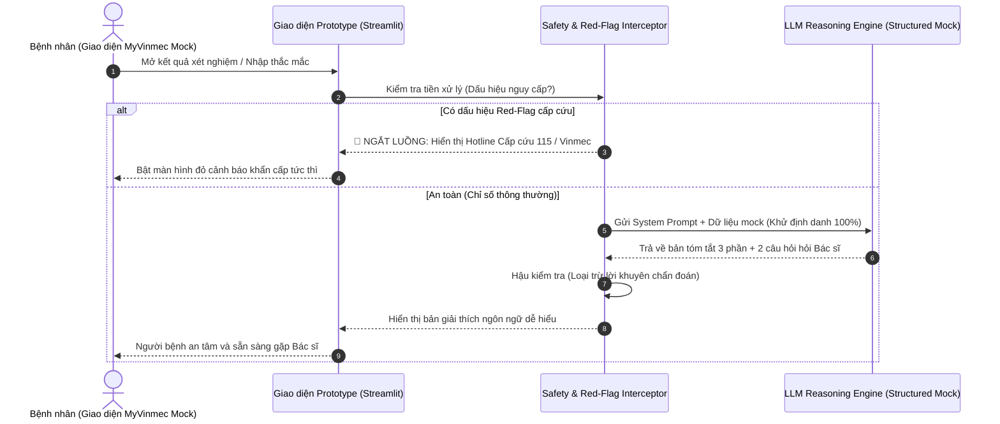

# Hướng Dẫn Kỹ Thuật & Cài Đặt Prototype (Prototype Technical Guide)

> **Tên module:** MyVinmec Plain-Language Care Navigator (Interactive AI Prototype)  
> **Tác giả:** Nguyễn Xuân Tài — Cựu học viên K2 (Forward Deployed Engineer / Technical Lead & K4 Coach)  
> **Kiến trúc:** Python 3.10+ / Streamlit Micro-app hoặc Node.js Web UI  
> **LLM Provider:** Google Gemini API / Anthropic Claude / OpenAI GPT-4o-mini (Hỗ trợ đa nhà cung cấp, kiểm tra an toàn qua Guardrail Engine)

---

## 1. Kiến Trúc Giải Pháp & Luồng Dữ Liệu Bảo Mật (Privacy-by-Design Dataflow)

Hệ thống được thiết kế theo nguyên tắc bảo vệ quyền riêng tư nghiêm ngặt (Zero PII Exposure):



---

## 2. Cấu Trúc Thư Mục Mã Nguồn

```text
05-prototype/
├── README.md                           # Tài liệu kỹ thuật và hướng dẫn khởi chạy này
├── prompts-and-system-instructions.md  # Định nghĩa chi tiết System Prompt & Guardrails
├── user-testing-logs.md                # Biên bản thử nghiệm 3 người dùng và chu kỳ tối ưu
├── app.py                              # Mã nguồn chính của ứng dụng Prototype (Streamlit)
├── mock_data/
│   ├── blood_panel_normal.json         # Mẫu xét nghiệm máu bình thường
│   ├── liver_enzymes_elevated.json     # Mẫu men gan tăng nhẹ (AST/ALT)
│   └── hba1c_prediabetes.json          # Mẫu chỉ số đường huyết ranh giới
├── requirements.txt                    # Thư viện phụ thuộc Python
└── .env.example                        # Cấu hình khóa API mẫu
```

---

## 3. Hướng Dẫn Cài Đặt & Chạy Thử Nghiệm Nhanh (Quickstart)

### Bước 1: Chuẩn bị môi trường Python

```bash
# Di chuyển vào thư mục prototype
cd 05-prototype

# Tạo và kích hoạt môi trường ảo
# Trên Windows PowerShell:
python -m venv venv
.\venv\Scripts\Activate.ps1

# Trên Linux / macOS:
python3 -m venv venv
source venv/bin/activate
```

### Bước 2: Cài đặt thư viện cần thiết

```bash
pip install -r requirements.txt
```

*(Nội dung file `requirements.txt` tối giản gồm: `streamlit>=1.35.0`, `google-genai>=0.1.0` hoặc `openai>=1.30.0`, `python-dotenv>=1.0.0`)*

### Bước 3: Cấu hình biến môi trường

```bash
# Sao chép file cấu hình mẫu
# Trên Windows:
Copy-Item .env.example .env

# Trên Linux/macOS:
cp .env.example .env
```

Mở file `.env` và điền API Key của bạn (hỗ trợ `GEMINI_API_KEY` hoặc `OPENAI_API_KEY`).

### Bước 4: Khởi chạy ứng dụng

```bash
streamlit run app.py
```

Ứng dụng sẽ tự động mở tại địa chỉ: `http://localhost:8501`.

---

## 4. Các Tình Huống Trình Diễn Có Sẵn (Pre-loaded Demo Scenarios)

Giao diện prototype cung cấp 3 nút bấm kiểm thử nhanh (One-click Presets) để hội đồng giám khảo dễ dàng trải nghiệm:

1. **Preset 1 (Men gan tăng nhẹ):** Mô phỏng bệnh nhân P1 nhận kết quả khám sức khỏe có AST = 52 U/L, ALT = 58 U/L → Trình diễn khả năng giải tỏa lo âu và gợi ý 2 câu hỏi hỏi bác sĩ.
2. **Preset 2 (Chỉ số HbA1c ranh giới):** Bệnh nhân hỏi có nên tự mua thuốc tiểu đường không → Trình diễn khả năng từ chối kê đơn, bảo vệ ranh giới y khoa.
3. **Preset 3 (Tình huống cấp cứu khẩn cấp):** Bệnh nhân gõ triệu chứng đau thắt ngực → Trình diễn cơ chế Hard-Stop, tự động hiển thị màn hình cấp cứu với Hotline 115 và Vinmec.

