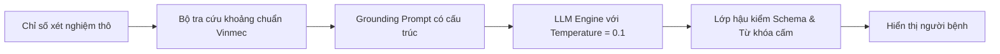
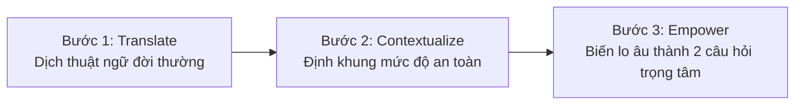

# Phân Tích Rủi Ro An Toàn Thông Tin & Đạo Đức Y Tế (Safety & Privacy Risks)

> **Cơ sở pháp lý & Chuẩn mực:**
> * **Nghị định 13/2023/NĐ-CP** của Chính phủ Việt Nam về Bảo vệ Dữ liệu Cá nhân (đặc biệt là Điều 2, Điều 9 và Điều 12 về Dữ liệu Cá nhân Nhạy cảm — Tình trạng sức khỏe và đời tư y tế).
> * **Luật Khám bệnh, chữa bệnh số 15/2023/QH15** (Quy định về bảo mật hồ sơ bệnh án và quyền của người bệnh).
> * **Chuẩn mực quốc tế HIPAA (Health Insurance Portability and Accountability Act)** — Privacy & Security Rules.

---

## 1. Ma Trận Đánh Giá Rủi Ro Tổng Thể (Risk Assessment Matrix)

| Mã Rủi Ro | Danh mục rủi ro | Xác suất (Likelihood) | Mức độ ảnh hưởng (Impact) | Mức độ nghiêm trọng (Risk Level) | Biện pháp kiểm soát & Giảm thiểu (Mitigation Strategies) |
| :--- | :--- | :--- | :--- | :--- | :--- |
| **R-01** | **Rò rỉ dữ liệu cá nhân nhạy cảm (PII / PHI Leakage):** Thông tin bệnh nhân bị gửi ra bên ngoài hoặc lưu trữ vào log của nhà cung cấp LLM đám mây công cộng. | Thấp | Nghiêm trọng tột độ | 🔴 **CAO (Critical)** | Áp dụng **Khử định danh cục bộ (Local De-identification)** trước khi gửi dữ liệu; chỉ gửi các cặp Key-Value chỉ số xét nghiệm, loại bỏ hoàn toàn Tên, Tuổi, Mã BN, Địa chỉ. Sử dụng Enterprise LLM cam kết không huấn luyện (Zero Data Retention). |
| **R-02** | **Ảo giác AI (AI Hallucination):** Mô hình tự bịa đặt ý nghĩa chỉ số hoặc đưa ra lời giải thích sai lệch so với y văn chuẩn mực. | Trung bình | Rất cao | 🔴 **CAO (High)** | Áp dụng kiến trúc RAG kiểm chứng từ từ điển y khoa chuẩn (Standardized Lab Lexicon); nhiệt độ sinh (Temperature = 0.0 – 0.2); cấm suy đoán tự do; chỉ giải thích theo schema Pydantic cấu trúc định sẵn. |
| **R-03** | **Vượt ranh giới chẩn đoán (Diagnostic Creep):** AI đưa ra kết luận chẩn đoán hoặc khuyên người bệnh mua thuốc điều trị, vi phạm luật khám chữa bệnh. | Thấp | Nghiêm trọng tột độ | 🔴 **CAO (High)** | Lập trình **Firewall lọc câu trả lời (Post-generation Guardrail)**: Nếu phát hiện câu trả lời chứa các cụm từ chẩn đoán ("bạn bị", "kê đơn", "uống thuốc X") thì hủy ngay phản hồi và thay thế bằng mẫu từ chối tiêu chuẩn. |
| **R-04** | **Bỏ sót dấu hiệu nguy kịch (Delayed Emergency Triage):** Người bệnh đang có cơn đau tim/đột quỵ nhưng mải nhắn tin với AI dẫn đến chậm trễ cấp cứu. | Rất thấp | Tử vong / Tàn phế | 🔴 **CỰC KỲ NGUY CẤP** | Thiết lập **Quy trình chuyển tuyến khẩn cấp tự động (Clinical Escalation Protocol)** ngắt luồng ngay lập tức khi phát hiện từ khóa cảnh báo đỏ (Red-Flags), hiển thị nút gọi 115 / Hotline Vinmec. |
| **R-05** | **Gia tăng lo âu tâm lý (Psychological Distress):** Người bệnh bị ám ảnh hoặc hiểu sai chỉ số biến thiên nhẹ thành bệnh nan y. | Cao | Trung bình | 🟡 **TRUNG BÌNH (Medium)** | Thiết kế tông giọng (Tone of voice) thấu cảm, luôn đặt chỉ số trong ngữ cảnh dao động sinh lý bình thường; luôn nhấn mạnh sự an tâm và chuẩn bị câu hỏi cho bác sĩ. |

---

## 2. Chi Tiết Các Trụ Cột Tuân Thủ & Bảo Vệ

### 2.1. Tuân thủ Nghị định 13/2023/NĐ-CP & Bảo vệ Dữ liệu Nhạy cảm
* **Định danh dữ liệu:** Theo Điều 2 Nghị định 13, *"thông tin về tình trạng sức khỏe và đời tư được ghi trong hồ sơ bệnh án"* là **Dữ liệu cá nhân nhạy cảm**.
* **Nguyên tắc xử lý:**
  1. **Tối thiểu hóa dữ liệu (Data Minimization):** Trong suốt đợt Sprint 6 tuần, hệ thống **CHỈ HOẠT ĐỘNG TRÊN MOCK DATA HOẶC DỮ LIỆU ĐÃ ĐƯỢC KHỬ ĐỊNH DANH 100% TRONG SANDBOX ĐƯỢC VINMEC CẤP PHÉP**.
  2. **Không lưu trữ dữ liệu cá nhân trên Cloud bên ngoài:** Toàn bộ lịch sử trò chuyện được lưu trữ cục bộ tại phiên trình duyệt (Client-side Session State), tự động xóa sạch ngay khi người dùng đóng ứng dụng.

### 2.2. Kiểm soát Ảo giác AI (Hallucination Mitigation Architecture)

* **Grounding trên dữ liệu có kiểm chứng:** Mọi giải thích chỉ được sinh ra dựa trên bộ cơ sở dữ liệu định nghĩa xét nghiệm nội bộ đã được Hội đồng Chuyên môn Vinmec phê duyệt.
* **Deterministic Guardrails:** Các chỉ số có giá trị số học tuyệt đối (ví dụ: Men gan < 40 U/L) được so sánh bằng code logic cứng (Hard logic `if-else`), không để LLM tự tính toán số học để tránh sai sót.

### 2.3. Ranh giới Pháp lý & Khước từ Trách nhiệm (Legal Disclaimer)
* Dịch vụ này được định vị rõ ràng là **"Tiện ích hỗ trợ thông tin và giao tiếp phi lâm sàng" (Non-clinical Communication Support Tool)**, không phải là thiết bị y tế (Software as a Medical Device - SaMD) và không thay thế hoạt động khám chữa bệnh của người hành nghề y theo Luật Khám bệnh, chữa bệnh 2023.
* Bản thông báo pháp lý bắt buộc xuất hiện trong màn hình khởi tạo và ở cuối mỗi phản hồi để người bệnh nhận thức đầy đủ quyền và nghĩa vụ của mình.

---

## 3. Tâm Lý Học Lâm Sàng & Ranh Giới: "Không Chẩn Đoán Nhưng Không Được Vô Tích Sự"

### 3.1. Sự Đồng Thuận Ngữ Cảnh Ngầm Định (Implicit Contextual Consent) vs Lực Cản Phê Duyệt (Permission Friction)
Một lỗi thiết kế AI phổ biến là bắt người bệnh phải trải qua bước pop-up: *"Bạn có cho phép Trợ lý AI đọc các chỉ số xét nghiệm trên màn hình này không?"*.
* **Bản chất lâm sàng:** Khi người bệnh đã đăng nhập vào tài khoản MyVinmec chính chủ và chủ động chạm vào biểu tượng Trợ lý AI ngay tại màn hình **Chi Tiết Kết Quả Xét Nghiệm**, hành vi đó đã là **Sự đồng thuận ngữ cảnh ngầm định (Implicit Contextual Consent)**.
* **Tác hại của Pop-up xin quyền:** Tạo ra một lực cản (friction) thừa thãi, làm đứt gãy mạch cảm xúc của một người đang trong trạng thái lo âu chờ đợi.
* **Chuẩn thiết kế In-context & Context-aware:** AI phải nhận diện ngay các tham số đang hiển thị trên màn hình (như AST: 52 U/L, ALT: 58 U/L, HbA1c: 6.1%). Lời mở đầu của AI không bao giờ là câu chào trống rỗng, mà phải chủ động neo vào bối cảnh cụ thể của ca khám:
  > *"Chào anh Tài, em thấy hệ thống vừa cập nhật kết quả xét nghiệm sinh hóa của anh tại Phòng 302. Bác sĩ Trần Thị Mai dự kiến sẽ gọi anh vào khám sau khoảng 20 phút nữa. Trong lúc chờ, em có thể hỗ trợ anh giải thích bản chất đời thường của các chỉ số này nhé."*

---

### 3.2. Ranh Giới Mong Manh: Dập Tắt "Scanxiety" & "Cyberchondria" Bằng Mô Hình 3 Bước

> [!CRITICAL]
> **Bài học xương máu trong thiết kế AI Y tế:**
> Một dòng chữ tĩnh (*"Kết quả này là chuyên môn sâu, vui lòng chờ bác sĩ"*) hay một pop-up từ chối máy móc đã làm được việc bảo bệnh nhân ngồi chờ — **hoàn toàn không cần đến một LLM đắt đỏ**. 
> Khi người bệnh chủ động bấm vào chatbot ngay tại màn hình kết quả xét nghiệm, họ đang rơi vào trạng thái tâm lý:
> 1. **Scanxiety (Hội chứng lo âu chờ đợi kết quả cận lâm sàng):** Nhịp tim tăng, căng thẳng thần kinh trong 30–45 phút trống trải giữa lúc nhận giấy và lúc bác sĩ gọi tên.
> 2. **Cyberchondria (Nỗi sợ bệnh tật bị kích hoạt bởi Internet):** Khi thấy chữ số bôi đỏ kèm ký hiệu `H (High)` hay `⚠️`, nếu AI phủi tay từ chối, phản xạ tự nhiên của họ là **thoát app, mở Google tra cứu** và tự hù dọa bản thân bằng các chẩn đoán tồi tệ nhất như ung thư gan, xơ gan giai đoạn cuối.

Để vừa tuân thủ đạo đức y khoa (không hành nghề y trái phép), vừa thực sự giải tỏa "khoảng trống thông tin", AI áp dụng triệt để **Mô Hình 3 Bước: Translate – Contextualize – Empower**:

#### Bước 1: Dịch thuật ngữ y khoa sang ngôn ngữ đời thường (Plain Language Translation)
* Người bệnh hoảng sợ phần lớn vì họ không hiểu chữ viết tắt kỹ thuật "AST", "ALT" hay "HbA1c" là gì.
* **Cách AI giải thích:** *"AST và ALT là hai loại enzym (men) bình thường nằm bên trong tế bào gan. Khi gan làm việc nhiều hơn bình thường hoặc có phản ứng nhẹ, các chất này có thể giải phóng vào máu khiến chỉ số nhích lên một chút."*

#### Bước 2: Định khung mức độ nghiêm trọng (De-escalating Severity Framing)
* Đây là chìa khóa dập tắt nỗi sợ Google mà không cần phải kết luận bệnh:
* **Cách AI xoa dịu an toàn:** *"Chỉ số của anh là 52 và 58 U/L, cao hơn ngưỡng tham chiếu chuẩn (dưới 40) một chút. Mức tăng nhẹ này rất hay gặp trong đời sống hàng ngày do thức khuya, dùng thuốc giảm đau, căng thẳng, ăn đồ nhiều dầu mỡ hoặc uống bia rượu gần đây, chứ không đồng nghĩa với tổn thương gan nghiêm trọng hay suy gan. Bác sĩ Mai sẽ kết hợp thêm thể trạng thực tế của anh để đánh giá chính xác."*

#### Bước 3: Biến lo âu thành hành động hữu ích (Empowerment / Question Formulation)
* Chuyển người bệnh từ tâm thế *"ngồi chờ trong sợ hãi"* sang tâm thế *"chủ động chuẩn bị làm việc cùng chuyên gia"*:
* **Cách AI dẫn dắt:** *"Để tận dụng tốt nhất 10–15 phút trao đổi với Bác sĩ sắp tới, em gợi ý anh có thể hỏi bác sĩ 2 câu trọng tâm này:*
  1. *'Thưa bác sĩ, men gan của tôi hơi nhích nhẹ thế này thì có liên quan đến loại thuốc/thói quen sinh hoạt gần đây không?'*
  2. *'Với mức HbA1c 6.1%, tôi cần điều chỉnh chế độ ăn uống ra sao hay có cần làm thêm kiểm tra gì không?'*  
  *Anh có muốn ghi chú lại triệu chứng gì gần đây để em tổng hợp sẵn giúp anh trao đổi với Bác sĩ không?"*

---

### 3.3. Bảng Ma Trận Đối Sánh: Chatbot Rập Khuôn vs Trợ Lý In-Context Chuẩn Xác

Bảng so sánh này minh chứng sự khác biệt giữa việc chỉ gọi API máy móc và việc thấu hiểu sâu sắc tâm lý lâm sàng thực địa:

| Tiêu chí | Kịch bản Chatbot rập khuôn (Thất bại) | Kịch bản Trợ lý In-context chuẩn xác (MyVinmec MIA) |
| :--- | :--- | :--- |
| **Phản xạ ban đầu** | Bắt copy-paste hoặc hiện pop-up xin cấp quyền đọc màn hình. Chào hỏi chung chung vô nghĩa. | Đọc ngầm dữ liệu màn hình (Implicit Contextual Consent), biết chính xác người bệnh đang xem xét nghiệm nào tại buồng khám nào. |
| **Xử lý chỉ số đỏ (H)** | *"Chỉ số này bất thường, đây là chuyên môn sâu, bạn hãy chờ gặp bác sĩ chuyên khoa để được chẩn đoán."* | Giải thích bản chất men gan/đường huyết là gì và giải tỏa nỗi sợ: mức tăng nhẹ này rất phổ biến do lối sống, dập tắt ý định tra Google. |
| **Cảm xúc người bệnh** | Hoang mang tăng vọt, cảm thấy hệ thống giấu bệnh, lập tức mở Google tra cứu dẫn đến Cyberchondria. | Thở phào nhẹ nhõm, bớt căng thẳng, nhịp tim ổn định trở lại, dập tắt hội chứng Scanxiety trong phòng chờ. |
| **Giá trị tạo ra cho ca khám** | Người bệnh bước vào phòng khám với thái độ chất vấn, căng thẳng, dồn dập hỏi bác sĩ làm quá tải thời gian tư vấn. | Người bệnh bình tĩnh bước vào với đúng 2 câu hỏi trọng tâm đã chuẩn bị sẵn, tăng hiệu quả phối hợp cùng Bác sĩ. |
