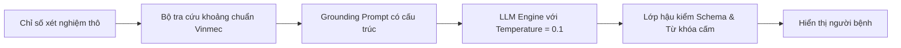

# Phân Tích Rủi Ro An Toàn Thông Tin & Đạo Đức Y Tế (Safety & Privacy Risks)

> **Cơ sở pháp lý & Chuẩn mực:**
> * **Nghị định 13/2023/NĐ-CP** của Chính phủ Việt Nam về Bảo vệ Dữ liệu Cá nhân (đặc biệt là Điều 2, Điều 9 và Điều 12 về Dữ liệu Cá nhân Nhạy cảm — Tình trạng sức khỏe và đời tư y tế).
> * **Luật Khám bệnh, chữa bệnh số 15/2023/QH15** (Quy định về bảo mật hồ sơ bệnh án và quyền của người bệnh).
> * **Chuẩn mực quốc tế HIPAA (Health Insurance Portability and Accountability Act)** — Privacy & Security Rules.

---

## 1. Ma Trận Đánh Giá Rủi Ro Tổng Thể (Risk Assessment Matrix)

| Mã Rủi Ro | Danh mục rủi ro | Xác suất (Likelihood) | Mức độ ảnh hưởng (Impact) | Mức độ nghiêm trọng (Risk Level) | Biện pháp kiểm soát & Giảm thiểu (Mitigation Strategies) |
| :--- | :--- | :--- | :--- | :--- | :--- |
| **R-01** | **Rò rỉ dữ liệu cá nhân nhạy cảm (PII / PHI Leakage):** Thông tin bệnh nhân bị gửi ra bên ngoài hoặc lưu trữ vào log của nhà cung cấp LLM đám mây công cộng. | Thấp | Nghiêm trọng tột độ | 🔴 **CAO (Critical)** | Áp dụng **Khử định danh cục bộ (Local De-identification)** trước khi gửi dữ liệu; chỉ gửi các cặp Key-Value chỉ số xét nghiệm, loại bỏ hoàn toàn Tên, Tuổi, Mã BN, Địa chỉ. Sử dụng Enterprise LLM cam kết không huấn luyện (Zero Data Retention). |
| **R-02** | **Ảo giác AI (AI Hallucination):** Mô hình tự bịa đặt ý nghĩa chỉ số hoặc đưa ra lời giải thích sai lệch so với y văn chuẩn mực. | Trung bình | Rất cao | 🔴 **CAO (High)** | Áp dụng kiến trúc RAG kiểm chứng từ từ điển y khoa chuẩn (Standardized Lab Lexicon); nhiệt độ sinh (Temperature = 0.0 – 0.2); cấm suy đoán tự do; chỉ giải thích theo schema Pydantic cấu trúc định sẵn. |
| **R-03** | **Vượt ranh giới chẩn đoán (Diagnostic Creep):** AI đưa ra kết luận chẩn đoán hoặc khuyên người bệnh mua thuốc điều trị, vi phạm luật khám chữa bệnh. | Thấp | Nghiêm trọng tột độ | 🔴 **CAO (High)** | Lập trình **Firewall lọc câu trả lời (Post-generation Guardrail)**: Nếu phát hiện câu trả lời chứa các cụm từ chẩn đoán ("bạn bị", "kê đơn", "uống thuốc X") thì hủy ngay phản hồi và thay thế bằng mẫu từ chối tiêu chuẩn. |
| **R-04** | **Bỏ sót dấu hiệu nguy kịch (Delayed Emergency Triage):** Người bệnh đang có cơn đau tim/đột quỵ nhưng mải nhắn tin với AI dẫn đến chậm trễ cấp cứu. | Rất thấp | Tử vong / Tàn phế | 🔴 **CỰC KỲ NGUY CẤP** | Thiết lập **Quy trình chuyển tuyến khẩn cấp tự động (Clinical Escalation Protocol)** ngắt luồng ngay lập tức khi phát hiện từ khóa cảnh báo đỏ (Red-Flags), hiển thị nút gọi 115 / Hotline Vinmec. |
| **R-05** | **Gia tăng lo âu tâm lý (Psychological Distress):** Người bệnh bị ám ảnh hoặc hiểu sai chỉ số biến thiên nhẹ thành bệnh nan y. | Cao | Trung bình | 🟡 **TRUNG BÌNH (Medium)** | Thiết kế tông giọng (Tone of voice) thấu cảm, luôn đặt chỉ số trong ngữ cảnh dao động sinh lý bình thường; luôn nhấn mạnh sự an tâm và chuẩn bị câu hỏi cho bác sĩ. |

---

## 2. Chi Tiết Các Trụ Cột Tuân Thủ & Bảo Vệ

### 2.1. Tuân thủ Nghị định 13/2023/NĐ-CP & Bảo vệ Dữ liệu Nhạy cảm
* **Định danh dữ liệu:** Theo Điều 2 Nghị định 13, *"thông tin về tình trạng sức khỏe và đời tư được ghi trong hồ sơ bệnh án"* là **Dữ liệu cá nhân nhạy cảm**.
* **Nguyên tắc xử lý:**
  1. **Tối thiểu hóa dữ liệu (Data Minimization):** Trong suốt đợt Sprint 6 tuần, hệ thống **CHỈ HOẠT ĐỘNG TRÊN MOCK DATA HOẶC DỮ LIỆU ĐÃ ĐƯỢC KHỬ ĐỊNH DANH 100% TRONG SANDBOX ĐƯỢC VINMEC CẤP PHÉP**.
  2. **Không lưu trữ dữ liệu cá nhân trên Cloud bên ngoài:** Toàn bộ lịch sử trò chuyện được lưu trữ cục bộ tại phiên trình duyệt (Client-side Session State), tự động xóa sạch ngay khi người dùng đóng ứng dụng.

### 2.2. Kiểm soát Ảo giác AI (Hallucination Mitigation Architecture)

* **Grounding trên dữ liệu có kiểm chứng:** Mọi giải thích chỉ được sinh ra dựa trên bộ cơ sở dữ liệu định nghĩa xét nghiệm nội bộ đã được Hội đồng Chuyên môn Vinmec phê duyệt.
* **Deterministic Guardrails:** Các chỉ số có giá trị số học tuyệt đối (ví dụ: Men gan < 40 U/L) được so sánh bằng code logic cứng (Hard logic `if-else`), không để LLM tự tính toán số học để tránh sai sót.

### 2.3. Ranh giới Pháp lý & Khước từ Trách nhiệm (Legal Disclaimer)
* Dịch vụ này được định vị rõ ràng là **"Tiện ích hỗ trợ thông tin và giao tiếp phi lâm sàng" (Non-clinical Communication Support Tool)**, không phải là thiết bị y tế (Software as a Medical Device - SaMD) và không thay thế hoạt động khám chữa bệnh của người hành nghề y theo Luật Khám bệnh, chữa bệnh 2023.
* Bản thông báo pháp lý bắt buộc xuất hiện trong màn hình khởi tạo và ở cuối mỗi phản hồi để người bệnh nhận thức đầy đủ quyền và nghĩa vụ của mình.
