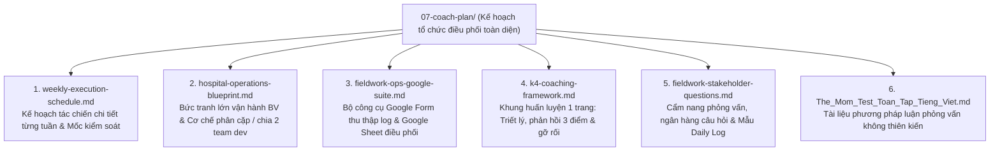

# Gói Kế Hoạch Huấn Luyện & Tác Chiến Khóa 4 (K4 Coaching & Operations Suite)

> **Người thực hiện:** Nguyễn Xuân Tài — K2 Lab Coach / Technical Lead & Forward Deployed Engineer  
> **Địa bàn triển khai:** Hệ thống Bệnh viện Đa khoa Quốc tế Vinmec  
> **Thời gian:** Exploration Sprint 6 Tuần (29/10/2026 – 13/12/2026)  
> **Đối tượng dẫn dắt:** Nhóm 5–10 học viên Khóa 4 (K4) Track 1 AI Product Management

---

## Danh Mục Tài Liệu Trong Thư Mục `07-coach-plan/`

Thư mục này được tổ chức thành 6 tài liệu chuyên biệt, bổ trợ chặt chẽ cho nhau, phục vụ từ khâu đào tạo tư duy, khảo sát hiện trường đến công cụ quản trị và chia nhóm dev:

---

## Tóm Tắt Chức Năng Của Từng Tài Liệu

### 1. [weekly-execution-schedule.md](./weekly-execution-schedule.md) — Kế Hoạch Tác Chiến Chi Tiết Từng Tuần
- **Nội dung:** Chi tiết hóa lịch trình từ **Tuần 0 (29/10/2026) đến Tuần 6 (13/12/2026)** bám sát lịch làm việc thực tế.
- **Quy tắc vận hành thép:**
  * **Hạn nộp cuối tuần 18h00 tối Chủ Nhật:** Học viên làm việc nhẹ nhàng từ xa; Coach chốt bài trong tối Chủ Nhật.
  * **Họp giao ban 15–20 phút sáng Thứ Hai:** Tuyệt đối không ngồi cãi nhau về ý tưởng; chỉ công bố quyết định và phân công tác chiến.
  * **Mốc chốt giữa tuần:** Thứ Năm chốt dữ liệu thực địa; sáng Thứ Sáu tổng hợp chéo; chiều Thứ Sáu bàn giao báo cáo / bảo vệ Cổng với Vinmec.

### 2. [hospital-operations-blueprint.md](./hospital-operations-blueprint.md) — Bức Tranh Lớn Vận Hành & Phân Chia Nhóm
- **Nội dung:** Bản đồ dịch vụ dòng chảy bệnh nhân (Patient Flow Service Blueprint) qua **4 Trạm nút thắt**: Tiếp đón $\rightarrow$ Khám lâm sàng $\rightarrow$ Cận lâm sàng $\rightarrow$ Nhà thuốc & Ra viện.
- **Sơ đồ tác chiến:** Bản đồ chỉ huy 4 khối phòng ban để chiếu màn hình lớn / TV trong 15 phút giao ban sáng.
- **Phân tích định lượng:** Tỷ lệ chiếm dụng 5–7 phòng ban trực tiếp / 35–45 phòng ban toàn viện (~12%–16%), hiện tượng tảng băng chìm hậu trường (85% Backstage).
- **Cơ chế phân chia nhân sự 3 giai đoạn:** Bốc thăm phân tầng cân bằng Tuần 0, Ma trận luân phiên không trùng lặp Tuần 1, và Cơ chế chống bẫy "Super Team" khi chia 2 Team Dev Tuần 2/3.

### 3. [fieldwork-ops-google-suite.md](./fieldwork-ops-google-suite.md) — Bộ Công Cụ Tác Chiến Google Suite (Form + Sheet)
- **Nội dung:** Cẩm nang vận hành hiện trường No-Code / Low-Code.
- **Google Form:** 13 trường nhập liệu chuẩn hóa The Mom Test, tích hợp QR Code để học viên quét nộp log bằng điện thoại trước 18h00 mỗi ngày.
- **Google Sheet:** Cấu trúc 3 Tab (`LICH_LUAN_PHIEN` chiếu TV, `RESPONSES_TAM_GIAC_HOA` tự động lọc theo trạm bằng hàm `=FILTER()`, `SCORECARD_CHIA_TEAM_DEV` chấm điểm chọn Lead).
- **Kịch bản vận hành 15 phút hàng ngày:** Nhắc nhở Zalo 17h30, đọc lướt 21h00, giao ban 08h30.

### 4. [k4-coaching-framework.md](./k4-coaching-framework.md) — Khung Huấn Luyện Cốt Lõi Của Coach K2
- **Nội dung:** Lộ trình 6 tuần tổng quan, triết lý huấn luyện, cơ chế đối kháng **Red Team vs Blue Team**, quy trình phản hồi 3 điểm (Praise - Bottleneck - Action), chiến lược gỡ rối khi nhóm bế tắc và thang điểm chấm chất lượng (Quality Gate Rubric).

### 5. [fieldwork-stakeholder-questions.md](./fieldwork-stakeholder-questions.md) — Cẩm Nang Phỏng Vấn & Mẫu Daily Field Log
- **Nội dung:** Handout phát tay cho học viên K4 bước vào hiện trường bệnh viện; ngân hàng câu hỏi phân tầng cho 6 nhóm nhân sự y tế (Bác sĩ, Điều dưỡng, Tiếp đón, IT HIS, Dược sĩ, Bệnh nhân) tuân thủ nghiêm ngặt kỹ thuật *The Mom Test*.
- **Phần VI:** Cung cấp biểu mẫu chuẩn **Nhật Ký Quan Sát Hiện Trường Hàng Ngày (Daily Field Observation Log Template)**.

### 6. [The_Mom_Test_Toan_Tap_Tieng_Viet.md](./The_Mom_Test_Toan_Tap_Tieng_Viet.md) — Sách The Mom Test Toàn Tập
- **Nội dung:** Bản dịch đầy đủ của cẩm nang kinh điển về phỏng vấn khách hàng của Rob Fitzpatrick, giúp học viên nhận biết các lời khen sáo rỗng, đào sâu vào hành vi quá khứ và né tránh bẫy thiên kiến giải pháp.
