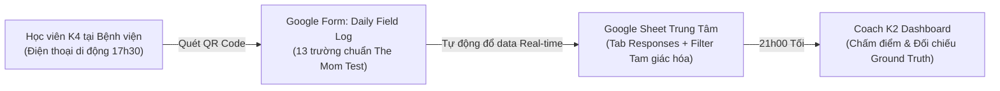
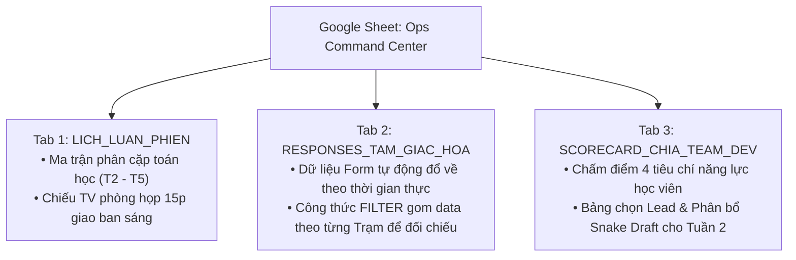

# Bộ Công Cụ Tác Chiến Google Suite: Google Form Thu Thập Log & Google Sheet Điều Phối Nhóm (Fieldwork Ops Google Suite)

> **Mục tiêu tài liệu:** Cung cấp giải pháp quản trị vận hành hiện trường tinh gọn (No-Code / Low-Code Ops) cho Coach K2.  
> **Nguyên tắc kỹ thuật:** **Tuyệt đối không tốn thời gian code tool riêng** cho đợt sprint 6 tuần. Bộ đôi Google Sheet + Google Form thiết lập trong 10 phút, hoạt động ổn định 24/7 trên điện thoại của học viên, tự động đồng bộ thời gian thực và đóng vai trò như một **Trung tâm Điều phối Tác chiến (Ops Command Dashboard)**.

---

## 1. Bản Đặc Tả Thiết Kế Google Form (Form Field Specifications)

Coach tạo một Google Form có tiêu đề:  
`📋 Vinmec Exploration Sprint K4 — Nhật Ký Quan Sát Hiện Trường Hàng Ngày`  
*(Cài đặt: Tự động thu thập email sinh viên, bật giới hạn 1 phản hồi/ngày, cho phép sửa sau khi gửi nếu cần).*



### Chi tiết 13 trường nhập liệu chuẩn hóa:

| STT | Tên trường (Question Title) | Loại câu hỏi (Input Type) | Bắt buộc? | Hướng dẫn gợi ý cho học viên |
| :---: | :--- | :--- | :---: | :--- |
| **1** | Họ và tên học viên | Trả lời ngắn (Short text) | ✅ Có | Nhập đầy đủ Họ tên có dấu (Ví dụ: Nguyễn Văn A). |
| **2** | Mã học viên K4 | Trả lời ngắn (Short text) | ✅ Có | Ví dụ: `K4-012`. |
| **3** | Ngày đi thực địa | Ngày (Date) | ✅ Có | Chọn ngày trong tuần (DD/MM/YYYY). |
| **4** | Trạm trực chiến hôm nay | Trắc nghiệm (Multiple Choice) | ✅ Có | • Trạm 1 (Tiếp đón & Kiosk BHYT)<br>• Trạm 2 (Khám lâm sàng & Sảnh chờ)<br>• Trạm 3 (Cận lâm sàng & Chẩn đoán hình ảnh)<br>• Trạm 4 (Thu ngân, Nhà thuốc & Ra viện) |
| **5** | Bạn cặp cùng trực hôm nay | Trả lời ngắn (Short text) | ✅ Có | Tên bạn cặp (theo bảng phân công sáng nay). |
| **6** | Thời gian chờ trung bình đo được (phút) | Số (Number) | ✅ Có | Bấm giờ thực tế bằng đồng hồ (Ví dụ: 35). |
| **7** | Số lượt người bệnh hỏi lặp lại cùng câu | Số (Number) | ✅ Có | Đếm số người hỏi cùng 1 câu hỏi tại trạm (Ví dụ: 8). |
| **8** | Cử chỉ bối rối & Cách "chữa cháy" (Workarounds) | Đoạn văn (Paragraph) | ✅ Có | Mô tả nét mặt, ánh mắt tìm biển chỉ dẫn, giấy dán tay của điều dưỡng... |
| **9** | **Quote nguyên văn Người bệnh / Người nhà** | Đoạn văn (Paragraph) | ✅ Có | **Chuẩn The Mom Test:** Ghi chính xác nguyên văn, kèm giọng điệu, tiếng thở dài, từ ngữ bình dân. |
| **10** | Quote nguyên văn Bác sĩ / Điều dưỡng | Đoạn văn (Paragraph) | ⚪ Không | Ghi nhận câu than phiền hoặc câu giải thích lặp đi lặp lại của nhân viên y tế. |
| **11** | Điểm nghẽn quy trình lớn nhất phát hiện | Đoạn văn (Paragraph) | ✅ Có | Chỉ rõ điểm đứt gãy giữa 2 khâu hoặc quá tải nhận thức của người bệnh. |
| **12** | Mức độ nghiêm trọng của điểm nghẽn | Thang đo tuyến tính (Linear 1–5) | ✅ Có | 1: Khó chịu nhẹ $\rightarrow$ 5: Nguy cơ an toàn / Bỏ khám về nhà. |
| **13** | Giả thuyết & Góc nhìn cải tiến của bạn | Đoạn văn (Paragraph) | ✅ Có | Bạn nghĩ nguyên nhân sâu xa là gì? Có giải pháp nào xử lý tận gốc? |

---

## 2. Kiến Trúc 3 Tab Trong Google Sheet Điều Phối Tác Chiến

Google Form liên kết với một Google Sheet có tên: `[VINMEC_K4]_Fieldwork_Ops_Command_Center`. Sheet được cấu trúc gồm **3 Tab chức năng**:



---

### Tab 1: `LICH_LUAN_PHIEN` (Chiếu Màn Hình Lớn Sáng Thứ Hai)

Bảng phân công trực chiến tự động cho nhóm 8 học viên ($S_1 \dots S_8$). Coach chỉ cần mở tab này chiếu lên TV:

| Ngày | Khung giờ | Trạm 1 (Tiếp đón & BHYT) | Trạm 2 (Khám chuyên khoa) | Trạm 3 (Cận lâm sàng & MRI) | Trạm 4 (Nhà thuốc & Ra viện) |
| :---: | :---: | :---: | :---: | :---: | :---: |
| **Thứ Hai (02/11)** | 08h30 – 16h30 | Cặp $(S_1, S_2)$ | Cặp $(S_3, S_4)$ | Cặp $(S_5, S_6)$ | Cặp $(S_7, S_8)$ |
| **Thứ Ba (03/11)** | 08h30 – 16h30 | Cặp $(S_6, S_8)$ | Cặp $(S_1, S_3)$ | Cặp $(S_2, S_4)$ | Cặp $(S_5, S_7)$ |
| **Thứ Tư (04/11)** | 08h30 – 16h30 | Cặp $(S_3, S_7)$ | Cặp $(S_4, S_8)$ | Cặp $(S_1, S_5)$ | Cặp $(S_2, S_6)$ |
| **Thứ Năm (05/11)**| 08h30 – 16h30 | Cặp $(S_2, S_8)$ | Cặp $(S_3, S_5)$ | Cặp $(S_4, S_6)$ | Cặp $(S_1, S_7)$ |
| **Thứ Sáu (06/11)**| **09h00 – 17h00** | **TẬP TRUNG TẠI PHÒNG LÀM VIỆC VINMEC: TỔNG HỢP CHÉO & BÀN GIAO LẦN 1** |

---

### Tab 2: `RESPONSES_TAM_GIAC_HOA` (Đối Chiếu Dữ Liệu Khách Quan)

Nhận toàn bộ dữ liệu thô từ Google Form. Bên cạnh bảng dữ liệu gốc, Coach thiết lập sẵn 4 khối bảng lọc tự động bằng công thức Google Sheet:

```excel
=FILTER('Form Responses 1'!A2:M, 'Form Responses 1'!D2:D="Trạm 3 (Cận lâm sàng & Chẩn đoán hình ảnh)")
```

* **Giá trị chắt lọc Ground Truth:** Vào sáng Thứ Sáu, Coach chỉ cần nhìn vào khối Trạm 3:
  - Nếu thấy cả $S_5$ (Thứ Hai), $S_2$ (Thứ Ba), $S_1$ (Thứ Tư) và $S_4$ (Thứ Năm) đều độc lập ghi: *"Bệnh nhân đi lạc giữa tầng 1 và tầng 2, mất 20 phút tìm phòng MRI"* $\rightarrow$ **Đây là Sự thật khách quan 100%**, biến thành luận điểm thép cho Need Statement!

---

### Tab 3: `SCORECARD_CHIA_TEAM_DEV` (Chấm Điểm & Phân Chia 2 Team Dev)

Bảng theo dõi và đánh giá năng lực từng học viên sau 4 ngày đi thực địa:

| Mã HV | Họ và tên | Chuyên cần / Kỷ luật (Thang 10) | Độ thấu cảm & Quotes The Mom Test (Thang 10) | Tư duy Hệ thống / Điểm nghẽn (Thang 10) | Điểm tổng kết | Vai trò chỉ định cho Tuần 2 & 3 | Nhóm phân bổ |
| :---: | :--- | :---: | :---: | :---: | :---: | :---: | :---: |
| $S_1$ | Nguyễn Văn A | 10 | 9.5 | 9.0 | **28.5** | **Lead Team Dev A (Care Navigator)** | **Team A** |
| $S_4$ | Trần Thị B | 10 | 9.0 | 9.5 | **28.5** | **Lead Team Dev B (Live Wayfinding)** | **Team B** |
| $S_2$ | Lê Văn C | 9.5 | 8.0 | 8.5 | 26.0 | Frontend Dev (Streamlit / Figma) | Team A (Snake Draft) |
| $S_5$ | Phạm Thị D | 9.0 | 8.5 | 8.0 | 25.5 | Prompt / RAG Pipeline Dev | Team B (Snake Draft) |
| $S_3$ | Hoàng Văn E | 9.0 | 7.5 | 8.0 | 24.5 | UI/UX Designer | Team B (Snake Draft) |
| $S_6$ | Vũ Thị F | 8.5 | 8.0 | 7.5 | 24.0 | UI/UX Designer | Team A (Snake Draft) |
| $S_7$ | Đỗ Văn G | 9.0 | 7.0 | 7.5 | 23.5 | Mock Data & User Testing Lead | Team A (Snake Draft) |
| $S_8$ | Bùi Thị H | 8.5 | 7.0 | 7.0 | 22.5 | Mock Data & User Testing Lead | Team B (Snake Draft) |

---

## 3. Kịch Bản Vận Hành 15 Phút Hàng Ngày Của Coach (Daily Ops Rhythm)

Để việc quản lý nhẹ nhàng, chuyên nghiệp và không tốn sức:

1. **17h30 chiều:** Bot tự động (hoặc Coach nhắn 1 tin ghim Zalo):  
   *"🔔 Đã đến 17h30. Các bạn hoàn tất ca trực và điền Daily Field Log qua link Google Form trước 18h00 nhé!"*
2. **18h00 chiều:** Khóa sổ nhận log ngày hôm đó.
3. **21h00 tối (10 phút duyệt nhanh):** Coach mở điện thoại xem Tab 2 trên Google Sheet. Đọc lướt qua các câu quotes ấn tượng và các điểm nghẽn nghiêm trọng mức 4–5.
4. **08h30 sáng hôm sau (15–20 phút giao ban):**
   - Mở màn hình lớn phòng họp Vinmec chiếu đồng thời:
     * **Bản đồ chỉ huy tác chiến (Macro Command Map)** trong `hospital-operations-blueprint.md`.
     * **Tab 1: `LICH_LUAN_PHIEN`** trên Google Sheet.
   - Coach điểm danh nhanh, khen ngợi 1 quote xuất sắc nhất của ngày hôm qua, chỉ định rõ hôm nay Cặp nào xuất phát đi Trạm nào.
   - Đúng 08h50: Các cặp tản ra hiện trường, bắt đầu ngày làm việc mới trong kỷ luật tuyệt đối!
