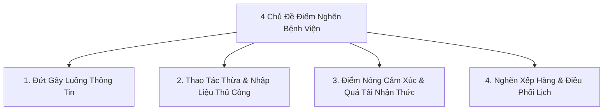

# Tài Liệu Bàn Giao Nhóm K4: Cẩm Nang Phỏng Vấn Thực Địa & Ngân Hàng Câu Hỏi Bệnh Viện (K4 Fieldwork Toolkit)

> **Tài liệu bàn giao (Mentee Handout):** Do Coach / Technical Lead K2 biên soạn dành riêng cho các thành viên nhóm học viên Khóa 4 (K4) khi bước vào Tuần 1 đợt Exploration Sprint tại Hệ thống Y tế Vinmec.  
> **Mục tiêu chuyển giao:** Hướng dẫn các bạn K4 tâm thế quan sát hiện trường, kỹ thuật tâm lý học giao tiếp (The Mom Test, Contextual Inquiry) và cung cấp sẵn ngân hàng câu hỏi chuẩn cho 6 nhóm nhân sự trong viện (Bác sĩ, Điều dưỡng, Tiếp đón, IT HIS, Dược sĩ, Bệnh nhân) để nhóm tự tin đi thực địa mà không làm phiền y bác sĩ và không bị thiên kiến giải pháp/AI.  
> **Nguyên tắc bất biến cho K4:** **TUYỆT ĐỐI KHÔNG NHẮC ĐẾN CÔNG NGHỆ, TÍNH NĂNG HAY AI** khi trò chuyện với nhân viên y tế (Zero-Solution Bias / Solution-Blindness). Mục tiêu duy nhất là lắng nghe thấu cảm, bóc tách hành vi đã xảy ra, cảm xúc chân thật và phát hiện các điểm nghẽn (Bottlenecks) trong quy trình vận hành bệnh viện.  
> **Cơ sở phương pháp luận:** Tổng hợp từ **The Mom Test (Rob Fitzpatrick)**, **Contextual Inquiry** và **Stanford Biodesign Need Finding** (Track 1 AI Thực Chiến).

---

## PHẦN I: BẢN ĐỒ KỸ THUẬT TÂM LÝ HỌC TRONG PHỎNG VẤN THỰC ĐỊA

Trước khi đặt bất kỳ câu hỏi nào, một Product Lead giỏi phải rèn luyện 5 phản xạ tâm lý học sau:

### 1. Tâm thế "Shoshin" (Beginner's Mind — Người mới bắt đầu)
* Giả định mình hoàn toàn không biết gì về quy trình bệnh viện. Dù bạn hiểu rõ logic thuật toán hay cơ sở dữ liệu, hãy bước vào buồng khám với sự tôn trọng và khiêm nhường tối đa.
* Khi nhân sự y tế dùng biệt ngữ chuyên môn (tên loại thuốc, mã bảo hiểm, thuật ngữ cận lâm sàng), đừng gật đầu giả vờ hiểu. Hãy hỏi tò mò: *"Chị ơi, từ này trong ca trực của chị có nghĩa là gì ạ?"*.

### 2. Nguyên tắc vàng The Mom Test: Neo vào Quá khứ cụ thể (Past Behavior Anchor)
* **Cấm tuyệt đối:** Hỏi về tương lai hoặc ý kiến giả định (*"Anh có nghĩ việc này nên tự động hóa không?", "Chị có thấy tính năng này tiện không?"*). Con người có xu hướng trả lời làm hài lòng người hỏi (Social Desirability Bias).
* **Bắt buộc:** Luôn neo vào mốc thời gian và sự kiện đã xảy ra: *"Lần gần nhất việc đó xảy ra là khi nào?", "Sáng nay lúc 8 giờ chuyện gì đã diễn ra?"*.

### 3. Săn lùng "Hành vi chắp vá" (Workaround Hunting)
* Điểm đau thật sự không nằm ở những lời than thở chung chung. Nó nằm ở các **Workarounds (Hành vi chống chế/chắp vá)**:
  - Những cuốn sổ tay cá nhân để chép tay lại thông tin.
  - Các mẩu giấy note vàng dán quanh viền màn hình máy tính.
  - Các nhóm chat Zalo/Viber tự lập giữa bác sĩ và điều dưỡng để báo ca khẩn.
  - File Excel tự tạo để theo dõi riêng vì phần mềm bệnh viện không đáp ứng.
* *Nếu phát hiện Workaround, bạn đã chạm tới một Pain Point có giá trị triệu đô.*

### 4. Kỹ thuật "Khoảng lặng mang thai" (The Pregnant Pause — 3 đến 5 giây)
* Sau khi người được hỏi vừa dứt câu, **đừng vội hỏi câu tiếp theo**. Hãy giữ ánh mắt chăm chú lắng nghe, gật nhẹ đầu và im lặng từ 3 đến 5 giây.
* Tâm lý học chứng minh: Khoảng lặng tạo ra một áp lực vô hình khiến đối phương cảm thấy cần giải thích thêm. Chính sau khoảng lặng này, họ mới nói ra sự thật trần trụi và sâu kín nhất mà câu trả lời đầu tiên đã giấu đi.

### 5. Kỹ thuật phản chiếu ngôn ngữ (Mirroring / Active Listening)
* Lặp lại từ 1 đến 3 từ cuối cùng mang sắc thái cảm xúc của họ với ngữ điệu tò mò, ấm áp.
* *Ví dụ:* Bác sĩ than thở: *"...Cứ phải gõ lại mấy cái chẩn đoán này vào ba chỗ khác nhau, mất thời gian phát bực."*  
  → Kỹ sư phản chiếu: *"Mất thời gian phát bực ạ...?"* (dừng lại lắng nghe).  
  → Bác sĩ sẽ tự động bung ra toàn bộ ức chế về hệ thống phần mềm mà không cảm thấy đang bị tra hỏi.

---

## PHẦN II: NGÂN HÀNG CÂU HỎI PHÂN LOẠI THEO 6 ĐỐI TƯỢNG BỆNH VIỆN

---

### ĐỐI TƯỢNG 1: BÁC SĨ ĐIỀU TRỊ / BÁC SĨ PHÒNG KHÁM NGOẠI TRÚ
> **Trọng tâm quan sát:** Áp lực thời gian khám (15–20 phút/ca), gánh nặng nhập liệu hồ sơ bệnh án (Documentation Burden), sự phân tâm giữa màn hình máy tính và ánh mắt người bệnh.

#### 1.1. Bóc tách áp lực thao tác & phân tâm:
1. *"Trong cả ca khám sáng nay từ 8h đến 11h, khoảnh khắc nào làm bác sĩ cảm thấy bị đứt mạch suy nghĩ hoặc mất tập trung nhất?"*
2. *"Khi người bệnh đang ngồi đối diện kể triệu chứng, bác sĩ thường phải làm song song những việc gì trên bàn làm việc?"*
3. *"Có bước nào trong lúc ghi nhận bệnh án mà bác sĩ phải làm đi làm lại nhiều lần cho cùng một bệnh nhân không?"*

#### 1.2. Khoảnh khắc trả & giải thích kết quả cận lâm sàng:
4. *"Khi bệnh nhân cầm kết quả xét nghiệm/chụp chiếu quay lại phòng khám, thường mất bao lâu để bác sĩ nắm được toàn cảnh tình trạng của họ?"*
5. *"Câu hỏi nào của người bệnh sau khi họ đọc kết quả cận lâm sàng khiến bác sĩ phải tốn nhiều thời gian giải thích nhất?"*
6. *"Có khi nào kết quả trên hệ thống chưa kịp nhảy về máy của bác sĩ mà bệnh nhân đã đứng đợi trước cửa phòng chưa? Lúc đó bác sĩ xử lý thế nào?"*

#### 1.3. Hậu quả & Điểm nghẽn cuối ngày:
7. *"Sau khi ca khám kết thúc, bác sĩ thường phải ở lại phòng làm việc bao lâu để hoàn tất các giấy tờ/thủ tục còn tồn đọng?"*
8. *"Lần gần nhất bác sĩ cảm thấy một ca khám bị kéo dài quá mức dự kiến là do nguyên nhân gì đã xảy ra?"*

---

### ĐỐI TƯỢNG 2: ĐIỀU DƯỠNG TRƯỞNG & ĐIỀU DƯỠNG PHÒNG KHÁM / BUỒNG BỆNH
> **Trọng tâm quan sát:** Điều phối luồng bệnh nhân, giải tỏa sự sốt ruột của người nhà, di chuyển cơ học giữa các phòng, lấy mẫu và bàn giao thông tin.

#### 2.1. Quan sát luồng di chuyển cơ học (Shadowing):
1. *"Lúc nãy em thấy chị phải đi lại giữa phòng khám này và quầy trực 3 lần liên tiếp, bước đó mình đang cần xác nhận điều gì thế chị?"*
2. *"Mỗi ngày điều dưỡng phải tự tay mang những loại giấy tờ hoặc vật phẩm nào đi bộ giữa các khoa phòng?"*
3. *"Khung giờ nào trong ngày là lúc buồng trực của chị nhận nhiều chuông gọi hoặc nhiều người nhà đứng chờ hỏi nhất?"*

#### 2.2. Giao tiếp & Giải tỏa ức chế cho người bệnh:
4. *"Lúc người bệnh hoặc người nhà tỏ ra sốt ruột, khó chịu nhất, thường là vì họ đang phải chờ bước nào (chờ xét nghiệm, chờ kết quả hay chờ bác sĩ gọi tên)?"*
5. *"Chị thường dặn người bệnh câu gì nhiều nhất trong một ngày? Câu dặn nào mà dặn xong họ vẫn hay quên hoặc hỏi lại?"*
6. *"Khi một ca khám trước bị kéo dài làm trễ lịch của 3 bệnh nhân đang ngồi đợi phía sau, chị thường xử lý tình huống đó bằng cách nào?"*

#### 2.3. Bàn giao ca trực & Thông tin chắp vá:
7. *"Lúc giao ca trực, thông tin quan trọng nào về người bệnh dễ bị sót nhất nếu không có người nhắc miệng?"*
8. *"Chị có cuốn sổ tay hay ghi chú riêng nào để nhớ lịch theo dõi bệnh nhân không? Cho em xem một trang chị vừa ghi sáng nay với ạ?"* *(Workaround Check)*

---

### ĐỐI TƯỢNG 3: DƯỢC SĨ QUẦY THUỐC NGOẠI TRÚ
> **Trọng tâm quan sát:** Đọc hiểu đơn thuốc bác sĩ, hướng dẫn sử dụng, đối soát viện phí thuốc, giải quyết thắc mắc về giá và danh mục bảo hiểm.

#### 3.1. Điểm nghẽn đọc hiểu & Đối soát:
1. *"Lần gần nhất một đơn thuốc bị ngưng lại ở quầy thuốc để chị phải gọi điện xác nhận lại với bác sĩ là vì lý do gì?"*
2. *"Mỗi ngày có khoảng bao nhiêu ca người bệnh đến quầy thuốc nhưng đơn chưa được đẩy sang hệ thống của dược?"*

#### 3.2. Áp lực tư vấn & Trải nghiệm người nhận thuốc:
3. *"Sau khi nhận cả bọc thuốc, câu hỏi phổ biến nhất mà người bệnh đứng hỏi lại chị là gì?"*
4. *"Có những loại thuốc nào có cách uống phức tạp (uống trước ăn, sau ăn, chia liều nhỏ) mà chị cảm thấy giải thích bằng miệng người ta rất khó nhớ hết không?"*
5. *"Khi người bệnh nhìn thấy hóa đơn tiền thuốc và bất ngờ vì chi phí, cuộc hội thoại ở quầy lúc đó thường diễn ra như thế nào?"*

---

### ĐỐI TƯỢNG 4: LỄ TÂN / THU NGÂN / NHÂN SỰ BẢO HIỂM (FRONT-DESK & BILLING)
> **Trọng tâm quan sát:** Điểm chạm đầu tiên và cuối cùng, xung đột thủ tục hành chính, đối soát bảo hiểm y tế tư nhân, bệnh nhân đến muộn / sai giờ hẹn trên app.

#### 4.1. Lệch pha giữa Ứng dụng số và Hiện trường đón tiếp:
1. *"Có nhiều trường hợp người bệnh chìa màn hình app MyVinmec bảo 'Tôi đã đặt lịch lúc 7h30' nhưng hệ thống của quầy lại không có tên hoặc hiển thị giờ khác không anh/chị?"*
2. *"Khi người bệnh đến muộn hơn giờ hẹn trên app (hoặc đến quá sớm), quầy lễ tân điều phối họ vào luồng khám thế nào?"*
3. *"Thao tác nào ở quầy check-in khiến người bệnh phải đứng chờ lâu nhất (quét thẻ, xác nhận thông tin cá nhân hay hỏi chuyên khoa)?"*

#### 4.2. Điểm nóng cảm xúc về Thanh toán & Bảo hiểm:
4. *"Khoảnh khắc nào người bệnh hay to tiếng hoặc bức xúc nhất tại quầy của anh/chị?"*
5. *"Thủ tục bảo lãnh viện phí tư nhân thường bị kẹt lâu nhất ở bước nào giữa công ty bảo hiểm và bệnh viện?"*
6. *"Khi giải thích cho người bệnh về những khoản chi phí không được bảo hiểm chi trả, anh/chị thường gặp khó khăn gì nhất?"*

---

### ĐỐI TƯỢNG 5: BẢO VỆ, HƯỚNG DẪN VIÊN SẢNH & NHÂN VIÊN VỆ SINH
> **Trọng tâm quan sát:** Luồng di chuyển thực tế (Wayfinding Bottlenecks), những người bị lạc đường, khu vực quá tải và những góc khuất vận hành vô hình.

#### 5.1. Bác bảo vệ & Nhân viên điều hướng cửa sảnh:
1. *"Mỗi buổi sáng, người ta hay chạy lại hỏi bác câu hỏi gì nhiều nhất?"*
2. *"Có khoa phòng hay khu vực xét nghiệm nào mà người bệnh cứ đi lòng vòng mãi không tìm thấy đường vào không bác?"*
3. *"Bác thấy người bệnh và người nhà hay bị lúng túng nhất ở khâu nào: lúc mới bước vào cổng, lúc tìm chỗ gửi xe, hay lúc tìm cầu thang máy?"*
4. *"Khi thấy một người trông rất mệt mỏi hoặc hoang mang đứng giữa sảnh, bác thường làm gì để hỗ trợ họ?"*

#### 5.2. Cô/chú nhân viên vệ sinh & Hậu cần:
1. *"Khu vực hành lang hay phòng chờ nào trong bệnh viện là nơi đông đúc, ngột ngạt và lộn xộn nhất vào buổi sáng hả cô?"*
2. *"Thùng rác ở khu vực nào hay bị đầy nhanh nhất? Người ta hay vứt những thứ gì ở đó nhiều nhất (giấy lau, vỏ chai nước hay phiếu số thứ tự)?"*
3. *"Có những góc nào người nhà bệnh nhân hay ngồi bệt xuống sàn hoặc nằm mệt mỏi vì chờ đợi quá lâu không cô?"*

---

### ĐỐI TƯỢNG 6: NGƯỜI BỆNH & NGƯỜI NHÀ ĐI CÙNG (PATIENTS & CAREGIVERS)
> **Trọng tâm quan sát:** Mức độ hiểu biết, sự lo âu tâm lý (Anxiety Curve), rào cản thuật ngữ và sự hẫng hụt thông tin sau khi rời phòng khám.

#### 6.1. Trải nghiệm thao tác trên ứng dụng di động:
1. *"Khi đặt lịch khám trên app, bước nào làm anh/chị cảm thấy lúng túng hoặc mất kiên nhẫn nhất?"*
2. *"Lần gần nhất anh/chị phải hủy lịch hoặc đổi giờ khám trên app, chuyện gì đã xảy ra trên màn hình?"*
3. *"Anh/chị thấy việc nhân viên tổng đài gọi lại xác nhận sau khi đặt trên app là tiện lợi hay phiền phức? Vì sao?"*

#### 6.2. Khoảnh khắc nhận và đọc kết quả cận lâm sàng:
4. *"Khi điện thoại báo 'Đã có kết quả xét nghiệm', cảm xúc đầu tiên xuất hiện trong đầu anh/chị là gì?"*
5. *"Mở bảng kết quả ra xem, dòng nào hay ký hiệu nào làm anh/chị bối rối nhất? Anh/chị có hiểu ý nghĩa của các con số đó không?"*
6. *"Anh/chị có tra Google thử xem chỉ số đó có ý nghĩa gì không? Đọc xong trên mạng anh/chị cảm thấy an tâm hơn hay lo lắng hơn?"*

#### 6.3. Cảm giác bơ vơ sau buổi khám:
7. *"Sau khi bước ra khỏi phòng bác sĩ, anh/chị có nắm rõ 100% mình phải đi đâu tiếp theo và về nhà phải theo dõi cơ thể thế nào không?"*
8. *"Nếu có một điều ước để buổi đi khám hôm nay bớt mệt mỏi đi một nửa, anh/chị ước điều gì thay đổi đầu tiên?"*

---

## PHẦN III: BỘ CÂU HỎI PHÂN LOẠI THEO 4 CHỦ ĐỀ ĐIỂM NGHẼN HỆ THỐNG

Nếu bạn không tiếp cận theo chức danh mà tiếp cận theo **Luồng công việc (Workflow)**, hãy dùng bộ câu hỏi theo 4 chủ đề sau:

### Chủ đề 1: Đứt gãy luồng thông tin (Information Disconnect)
* *"Chuyện gì xảy ra khi thông tin ở khâu trước không truyền được tới khâu của anh/chị?"*
* *"Lần gần nhất hai khoa phòng phải cãi nhau hoặc hiểu lầm nhau về một ca bệnh là do thiếu thông tin gì?"*
* *"Người bệnh thường xuyên mang theo những hiểu lầm gì từ khâu khám bệnh sang khâu nhận thuốc/thanh toán?"*

### Chủ đề 2: Lãng phí thao tác & Sao chép thủ công (Manual Redundancy)
* *"Bước nào trong ngày khiến anh/chị cảm thấy mình đang biến thành 'cái máy gõ chữ' thay vì làm chuyên môn?"*
* *"Dữ liệu này anh/chị đã nhập ở máy tính rồi, tại sao vẫn phải viết tay lại vào một tờ phiếu kẹp hồ sơ?"*
* *"Nếu mất điện hoặc hệ thống mạng bị treo 15 phút, cả khoa phòng của anh/chị sẽ xoay xở như thế nào?"*

### Chủ đề 3: Điểm nóng cảm xúc & Quá tải nhận thức (Emotional Flashpoints & Cognitive Overload)
* *"Tình huống nào làm huyết áp của anh/chị tăng vọt hoặc cảm thấy kiệt sức nhất trong ngày?"*
* *"Người bệnh hỏi câu gì khiến anh/chị cảm thấy khó xử nhất vì không thuộc thẩm quyền của mình?"*
* *"Lúc nào là lúc người nhà bệnh nhân dễ nổi nóng nhất? Nguyên nhân sâu xa phía sau là gì?"*

### Chủ đề 4: Nghẽn xếp hàng & Lệch pha điều phối (Queuing & Scheduling Friction)
* *"Tại sao cùng một khung giờ 8h30 sáng lại có đến 5 bệnh nhân cùng xuất hiện trước cửa phòng?"*
* *"Thời gian 15 phút cho một lượt khám có đủ để hoàn tất cả việc hỏi bệnh, khám thực thể và tư vấn không? Những ca bị lố giờ thường rơi vào bệnh lý nào?"*
* *"Những bệnh nhân đặt lịch hẹn trước trên app và bệnh nhân đến khám đột xuất (vãng lai) được phân chia quyền ưu tiên như thế nào tại hiện trường?"*

---

## PHẦN IV: BẢNG TRA CỨU QUY TẮC "NÊN HỎI" VS "CẤM HỎI" (DO'S & DON'TS)

| Tình huống phỏng vấn | ❌ TUYỆT ĐỐI CẤM HỎI (Vi phạm quy chế & bias) | ✅ NÊN HỎI (Chuẩn tâm lý học & The Mom Test) |
| :--- | :--- | :--- |
| **Muốn biết họ có cần AI tự động hóa không** | *"Bác sĩ có muốn một công cụ AI tự động tóm tắt bệnh án không?"* | *"Lần gần nhất bác sĩ mất hơn 30 phút để viết tóm tắt bệnh án là ca nào? Lúc đó vướng ở khâu nào nhất?"* |
| **Muốn biết app MyVinmec có dễ dùng không** | *"Anh thấy giao diện app MyVinmec có thông minh và tiện lợi không?"* | *"Sáng nay khi mở app ra tìm khoa khám, mắt anh nhìn vào đâu đầu tiên? Nút nào anh bấm vào mà không phản hồi?"* |
| **Muốn hiểu về kết quả xét nghiệm** | *"Bệnh nhân có hiểu chỉ số Creatinine máu trên bảng kết quả không?"* | *"Khi nhìn vào bảng số này, từ nào đầu tiên làm anh cảm thấy hoang mang nhất? Anh đã làm gì sau khi đọc nó?"* |
| **Hỏi về sự chậm trễ** | *"Tại sao khâu xét nghiệm máu ở đây làm việc chậm thế chị?"* | *"Từ lúc lấy máu xong đến lúc có kết quả, ống nghiệm đó phải đi qua những bàn nào? Bước nào tốn nhiều thời gian chờ nhất?"* |
| **Hỏi về ý tưởng cải tiến** | *"Theo chị bệnh viện nên thêm tính năng gì để phục vụ tốt hơn?"* | *"Khi gặp vướng mắc ở bước này, hiện tại chị đang tự khắc phục bằng cách nào (viết sổ, gọi điện thoại hay nhờ ai)?"* |

---

## PHẦN V: GHI CHÚ BÀI HỌC CHO BẢN KẾ HOẠCH COACH K4

Khi hướng dẫn nhóm học viên Khóa 4 (Day 17–18) thực hiện phỏng vấn tại Vinmec:
1. **Kiểm tra Conversation Guide trước khi ra trận:** Thu hồi toàn bộ câu hỏi có chứa chữ *"AI"*, *"tự động"*, *"phần mềm"*, *"bạn có muốn"*.
2. **Theo sát hiện trường (Shadowing the Shadowers):** Nhắc học viên luôn cầm theo cuốn sổ tay nhỏ, ghi lại **quotes nguyên văn** (có cả tiếng thở dài, từ ngữ bình dân) thay vì ghi lại suy diễn của bản thân.
3. **Phát hiện Workarounds:** Dạy học viên chụp lại (nếu được phép) hoặc vẽ lại các cuốn sổ ghi tay, bảng dán ghi chú của nhân sự y tế để đưa vào bằng chứng cho Need Statement.
