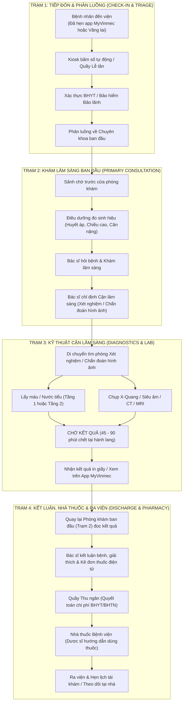
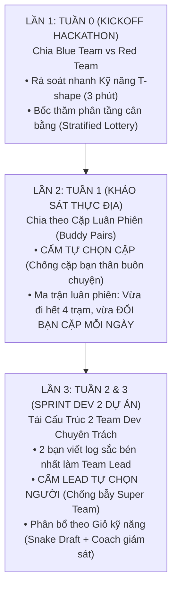

# Bức Tranh Lớn Vận Hành Bệnh Viện Đa Khoa & Cơ Chế Phân Chia Nhóm (Hospital Operations Blueprint)

> **Mục tiêu tài liệu:** Cung cấp cho Coach K2 và các học viên Khóa 4 (K4) một **Bản đồ dịch vụ toàn diện (Service Blueprint)** về dòng chảy bệnh nhân trong bệnh viện đa khoa Vinmec.  
> **Ứng dụng thực chiến:**  
> 1. Làm kim chỉ nam để **phân chia các Cặp (Pairs) khảo sát dữ liệu hiện trường** trong Tuần 1 mà không bỏ sót bất kỳ điểm nghẽn nào.  
> 2. Cung cấp cơ sở dữ liệu đối chiếu khách quan để **tái cấu trúc nhóm thành 2 Team Dev chuyên trách** trong Tuần 2 và Tuần 3.

---

## 1. Bản Đồ Dòng Chảy Bệnh Nhân Toàn Cảnh (Macro Patient Flow)

Trong một bệnh viện đa khoa quốc tế như Vinmec, quy trình khám chữa bệnh ngoại trú vận hành theo một chuỗi giá trị khép kín gồm 4 chặng then chốt:

---

## 2. Chi Tiết 4 Trạm Trọng Yếu & Danh Mục Điểm Nghẽn Tiềm Năng

| Trạm vận hành | Vị trí thực tế | Đối tượng tương tác | Điểm đau & Điểm nghẽn tiềm năng (Bottlenecks) |
| :--- | :--- | :--- | :--- |
| **TRẠM 1: Tiếp Đón & Phân Luồng** | Sảnh chính Tầng 1, Kiosk tự phục vụ, Quầy lễ tân. | Bệnh nhân mới, Người nhà, Nhân viên lễ tân, Bảo vệ. | • Bệnh nhân lúng túng giữa luồng hẹn trước và luồng vãng lai. • Thủ tục bảo lãnh viện phí mất 15–20 phút xác minh. • Chưa biết đi thang máy hay thang cuốn nào để đến đúng khoa. |
| **TRẠM 2: Khám Lâm Sàng Ngoại Trú** | Hành lang phòng khám Nội/Ngoại/Sản/Nhi. | Bệnh nhân ngồi chờ, Bác sĩ khám, Điều dưỡng trực cửa. | • **Thời gian chờ chết:** Ngồi chờ 30–45 phút nhưng chỉ được khám 7–10 phút. • Bệnh nhân vào gặp bác sĩ thì bị "quên mất câu cần hỏi". • Bác sĩ bị quá tải câu hỏi hành chính (giá thuốc, bảo hiểm, tìm phòng). |
| **TRẠM 3: Kỹ Thuật Cận Lâm Sàng** | Khu lấy máu, Phòng chụp X-quang, Siêu âm, MRI. | Bệnh nhân cầm giấy chỉ định, Kỹ thuật viên hình ảnh, Y tá. | • **Nghẽn điều hướng (Wayfinding Friction):** Đi lạc giữa các phòng khám cận lâm sàng phân tán ở nhiều tầng. • **Khủng hoảng tâm lý lúc nhận kết quả:** Cầm tờ kết quả xét nghiệm máu có chỉ số bôi đậm/mũi tên đỏ nhưng chưa được bác sĩ giải thích $\rightarrow$ Hoang mang tra Google. |
| **TRẠM 4: Trả Kết Quả, Dược & Ra Viện** | Quầy Thu ngân, Quầy Dược sảnh Tầng 1, Cửa ra viện. | Bệnh nhân hoàn tất khám, Dược sĩ phát thuốc, Thu ngân. | • Dồn ứ giờ cao điểm (10h30 – 11h30 trưa & 15h30 – 16h30 chiều). • Bệnh nhân nghe dược sĩ dặn thuốc 2 phút nhưng về nhà quên cách dùng. • Mất kết nối hậu khám: Bệnh nhân có tác dụng phụ nhẹ không biết hỏi ai. |

---

## 3. Chiến Lược Phân Chia Nhóm 3 Giai Đoạn (3-Stage Team Partitioning Architecture)

Để đảm bảo công bằng, triệt tiêu bè phái và tối ưu hóa năng lực học viên, Coach áp dụng cơ chế phân chia nhân sự qua 3 giai đoạn cốt lõi:

---

## 4. Lần 1 (Tuần 0): Chia Blue Team vs Red Team (Bốc Thăm Phân Tầng Cân Bằng)

Thay vì dùng các bài trắc nghiệm tính cách (MBTI) lý thuyết sáo rỗng, Coach K2 sử dụng **Bảng Rà Soát Kỹ Năng T-shape Nhanh (3 Phút - 4 Câu Hỏi Thực Chiến)** ngay buổi chiều Thứ Sáu nhận team:

### 4.1. Bảng rà soát 4 nhóm năng lực
1. **Năng lực Kỹ thuật (Tech/Code):** Đã từng viết Python, dùng Streamlit, gọi LLM API hoặc dùng Git chưa? (Có / Chưa).
2. **Năng lực Thiết kế & Trải nghiệm (UX/Product):** Có biết dùng Figma, vẽ User Flow hoặc phỏng vấn người dùng không?
3. **Năng lực Tư duy Phản biện (Critical Thinking):** Thích tìm lỗi hổng logic, soi rủi ro đạo đức hay thích xây dựng tính năng mới?
4. **Năng lực Viết & Trình bày (Documentation):** Có thế mạnh về tổng hợp báo cáo và làm slide không?

### 4.2. Cơ chế bốc thăm phân tầng (Stratified Skill-Balanced Lottery)
* **Quy tắc:** Coach chia danh sách học viên vào 3 rổ năng lực: (1) Rổ Dev/Code; (2) Rổ UX/Design; (3) Rổ Critical/Research.
* **Bốc thăm chia đôi:** Mỗi rổ bốc thăm ngẫu nhiên chia đều 50% sang Blue Team và 50% sang Red Team.
* **Kết quả:** Đảm bảo cả hai phe đều có người biết code (để soi mã nguồn prototype), đều có người biết vẽ flow và người có tư duy phản biện. Hai bên cân bằng lực lượng tuyệt đối, tránh tình trạng "bên quá giỏi, bên quá đuối".

---

## 5. Lần 2 (Tuần 1): Chia Cặp Khảo Sát Thực Địa (Ma Trận Luân Phiên Không Trùng Lặp)

### 5.1. Nguyên tắc kỷ luật thép
* **TUYỆT ĐỐI CẤM TỰ CHỌN BẠN CẶP:** Loại bỏ hoàn toàn tình trạng "cặp bạn thân" đi viện chỉ túm tụm cười nói buôn chuyện làm phiền bệnh viện.
* **Tránh ghép đôi xung đột:** Nếu trong nhóm có 2 bạn có xích mích hoặc không hợp tính nhau từ trước, Coach tách ra các cặp khác nhau.
* **Đảm bảo tính bao phủ & gắn kết tập thể (Double Invariant):**
  1. *Bất biến 1 (Station Coverage):* Mỗi cá nhân trong 4 ngày **bắt buộc phải đi qua đủ cả 4 trạm bệnh viện**.
  2. *Bất biến 2 (Social Rotation):* Mỗi ngày **phải đi cùng một bạn cặp mới**, tuyệt đối không đi trùng bạn cặp của ngày hôm trước. Đến hết tuần, ai cũng đã làm việc chung với các thành viên khác, hiểu rõ tính cách của nhau trước khi vào dev thật.

### 5.2. Ma trận phân công luân chuyển toán học (Ví dụ cho nhóm 8 học viên: $S_1 \dots S_8$)

| Lịch trực | Cặp Trạm 1 (Tiếp đón) | Cặp Trạm 2 (Phòng khám) | Cặp Trạm 3 (Cận lâm sàng) | Cặp Trạm 4 (Nhà thuốc & Ra viện) |
| :---: | :---: | :---: | :---: | :---: |
| **Thứ Hai** | Cặp $(S_1, S_2)$ | Cặp $(S_3, S_4)$ | Cặp $(S_5, S_6)$ | Cặp $(S_7, S_8)$ |
| **Thứ Ba** | Cặp $(S_6, S_8)$ | Cặp $(S_1, S_3)$ | Cặp $(S_2, S_4)$ | Cặp $(S_5, S_7)$ |
| **Thứ Tư** | Cặp $(S_3, S_7)$ | Cặp $(S_4, S_8)$ | Cặp $(S_1, S_5)$ | Cặp $(S_2, S_6)$ |
| **Thứ Năm**| Cặp $(S_2, S_8)$ | Cặp $(S_3, S_5)$ | Cặp $(S_4, S_6)$ | Cặp $(S_1, S_7)$ |
| **Thứ Sáu**| **Cả nhóm tập trung tại phòng làm việc Vinmec: Họp tổng hợp chéo dữ liệu & Soạn Báo cáo Tuần 1** |

*Kiểm chứng thuật ngữ:* Học viên $S_1$ lần lượt ghép với $S_2$ (Thứ Hai), $S_3$ (Thứ Ba), $S_5$ (Thứ Tư), $S_7$ (Thứ Năm). Mỗi ngày một bạn mới, đồng thời đi đủ $T_1 \rightarrow T_2 \rightarrow T_3 \rightarrow T_4$!

---

## 6. Lần 3 (Tuần 2 & 3): Tái Cấu Trúc 2 Team Dev (Chống Bẫy "Super Team")

Vào sáng Thứ Hai Tuần 2 (09/11), Coach công bố 2 Bài toán lớn đã được gạn lọc từ dữ liệu tuần 1. Việc chia thành **2 Team Dev chuyên trách (Team Dev A & Team Dev B)** phải tuân thủ nghiêm ngặt quy tắc chống bẫy độc quyền:

### 6.1. Nguyên tắc chống bẫy "Super Team" (Anti-Super-Team Rule)
* **Bản chất tâm lý học sinh tồn:** Nếu cho phép 2 Team Lead tự do chọn người, theo bản năng họ sẽ lập tức "vơ vét" toàn bộ những bạn giỏi nhất về team mình $\rightarrow$ Tạo ra **1 Super Team và 1 Team phế/bị bỏ rơi**. Điều này sẽ phá nát tinh thần đoàn kết, gây bất mãn và triệt tiêu hoàn toàn động lực học hỏi của các bạn yếu hơn.
* **Kỷ luật:** **TUYỆT ĐỐI KHÔNG CHO LEAD TỰ DO CHỌN THÀNH VIÊN.**

### 6.2. Quy trình phân bổ 4 bước theo "Giỏ Kỹ Năng" (Skill Basket Allocation)
1. **Bước 1 — Bổ nhiệm Team Lead (Merit-based):** 
   - Coach chỉ định **2 bạn có bản Daily Field Log sắc bén, thấu cảm và có tư duy hệ thống tốt nhất ở Tuần 1** làm Lead của 2 team. Hai bạn này sở hữu và chịu trách nhiệm bảo vệ Need Statement tại Cổng 1.
2. **Bước 2 — Phân rã các thành viên còn lại vào 3 Giỏ năng lực:**
   - *Giỏ Dev (Frontend & LLM/Prompting):* 2–4 bạn.
   - *Giỏ UX & Visual Design:* 2 bạn.
   - *Giỏ Data & Testing/Ops:* 2 bạn.
3. **Bước 3 — Snake Draft có Trọng tài Coach giám sát:**
   - Thay vì chọn tự do, 2 Lead chọn lần lượt theo thứ tự zic-zac (Snake Draft):
     * Vòng 1 (Giỏ Dev): Lead A chọn trước $\rightarrow$ Lead B nhận bạn còn lại.
     * Vòng 2 (Giỏ UX): Lead B chọn trước $\rightarrow$ Lead A nhận bạn còn lại.
     * Vòng 3 (Giỏ Data/Ops): Lead A chọn trước $\rightarrow$ Lead B nhận bạn còn lại.
4. **Bước 4 — Quyền Phủ Quyết & Điều Chuyển Của Coach (Coach Veto & Peer Mentoring):**
   - Coach quan sát hành vi của cả Tuần 1, nắm rõ ai làm việc ăn ý với ai, ai từng có xung đột.
   - **Coach can thiệp điều chuyển chéo nếu:**
     * Hai bạn có xích mích cá nhân vô tình bị xếp cùng team.
     * Một team bị lệch trình độ: Bắt buộc áp dụng nguyên tắc **Peer Mentoring (1 bạn cứng kèm 1 bạn yếu hơn)** để kéo nhau cùng tiến bộ.
5. **Bước 5 — Bốc thăm đề tài:**
   - Hai Lead bốc thăm công bằng để nhận **Bài toán 1 (Care Navigator)** hoặc **Bài toán 2 (Live Wayfinding & Triage)**.

---

## 7. Kế Hoạch Bàn Giao Sang Tuần 3 (Sprint Dev 14 Ngày)

Sau khi vượt qua **Cổng 1 vào Thứ Sáu 13/11/2026**:
1. Cả 2 Team Dev đã có cấu trúc nhân sự cân bằng 100%, không ai tị nạnh hay cảm thấy mình bị bỏ rơi.
2. Mỗi nhóm có đầy đủ 1 Product Lead + 2 Dev + 1 Tester/Data.
3. Cuối tuần 14–15/11 chuẩn bị môi trường và Mock Data.
4. **Sáng Thứ Hai 16/11/2026:** Đúng 08h30, cả 2 team mở nhánh repo và lao vào Sprint Dev prototype tốc lực mà không mất dù chỉ 1 phút để cãi nhau về nhân sự hay ý tưởng!

