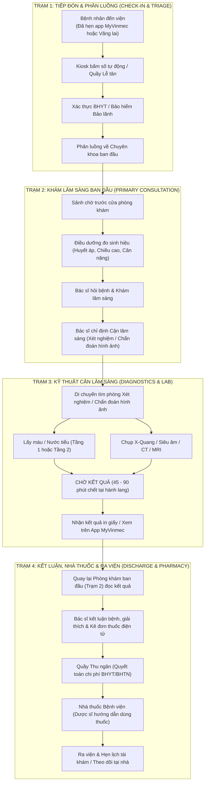
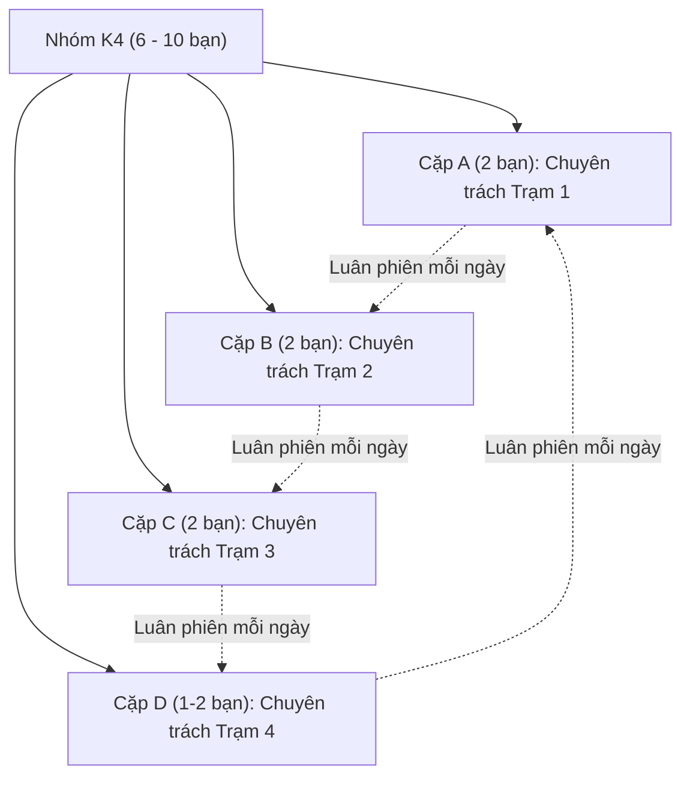
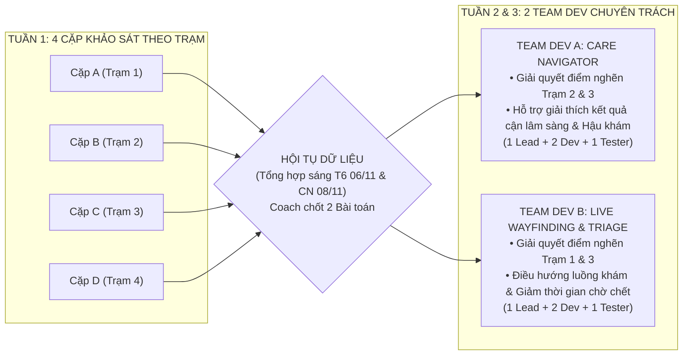

# Bức Tranh Lớn Vận Hành Bệnh Viện Đa Khoa & Cơ Chế Phân Chia Nhóm (Hospital Operations Blueprint)

> **Mục tiêu tài liệu:** Cung cấp cho Coach K2 và các học viên Khóa 4 (K4) một **Bản đồ dịch vụ toàn diện (Service Blueprint)** về dòng chảy bệnh nhân trong bệnh viện đa khoa Vinmec.  
> **Ứng dụng thực chiến:**  
> 1. Làm kim chỉ nam để **phân chia các Cặp (Pairs) khảo sát dữ liệu hiện trường** trong Tuần 1 mà không bỏ sót bất kỳ điểm nghẽn nào.  
> 2. Cung cấp cơ sở dữ liệu đối chiếu khách quan để **tái cấu trúc nhóm thành 2 Team Dev chuyên trách** trong Tuần 2 và Tuần 3.

---

## 1. Bản Đồ Dòng Chảy Bệnh Nhân Toàn Cảnh (Macro Patient Flow)

Trong một bệnh viện đa khoa quốc tế như Vinmec, quy trình khám chữa bệnh ngoại trú vận hành theo một chuỗi giá trị khép kín gồm 4 chặng then chốt:

---

## 2. Chi Tiết 4 Trạm Trọng Yếu & Danh Mục Điểm Nghẽn Tiềm Năng

| Trạm vận hành | Vị trí thực tế | Đối tượng tương tác | Điểm đau & Điểm nghẽn tiềm năng (Bottlenecks) |
| :--- | :--- | :--- | :--- |
| **TRẠM 1: Tiếp Đón & Phân Luồng** | Sảnh chính Tầng 1, Kiosk tự phục vụ, Quầy lễ tân. | Bệnh nhân mới, Người nhà, Nhân viên lễ tân, Bảo vệ. | • Bệnh nhân lúng túng giữa luồng hẹn trước và luồng vãng lai. • Thủ tục bảo lãnh viện phí mất 15–20 phút xác minh. • Chưa biết đi thang máy hay thang cuốn nào để đến đúng khoa. |
| **TRẠM 2: Khám Lâm Sàng Ngoại Trú** | Hành lang phòng khám Nội/Ngoại/Sản/Nhi. | Bệnh nhân ngồi chờ, Bác sĩ khám, Điều dưỡng trực cửa. | • **Thời gian chờ chết:** Ngồi chờ 30–45 phút nhưng chỉ được khám 7–10 phút. • Bệnh nhân vào gặp bác sĩ thì bị "quên mất câu cần hỏi". • Bác sĩ bị quá tải câu hỏi hành chính (giá thuốc, bảo hiểm, tìm phòng). |
| **TRẠM 3: Kỹ Thuật Cận Lâm Sàng** | Khu lấy máu, Phòng chụp X-quang, Siêu âm, MRI. | Bệnh nhân cầm giấy chỉ định, Kỹ thuật viên hình ảnh, Y tá. | • **Nghẽn điều hướng (Wayfinding Friction):** Đi lạc giữa các phòng khám cận lâm sàng phân tán ở nhiều tầng. • **Khủng hoảng tâm lý lúc nhận kết quả:** Cầm tờ kết quả xét nghiệm máu có chỉ số bôi đậm/mũi tên đỏ nhưng chưa được bác sĩ giải thích $\rightarrow$ Hoang mang tra Google. |
| **TRẠM 4: Trả Kết Quả, Dược & Ra Viện** | Quầy Thu ngân, Quầy Dược sảnh Tầng 1, Cửa ra viện. | Bệnh nhân hoàn tất khám, Dược sĩ phát thuốc, Thu ngân. | • Dồn ứ giờ cao điểm (10h30 – 11h30 trưa & 15h30 – 16h30 chiều). • Bệnh nhân nghe dược sĩ dặn thuốc 2 phút nhưng về nhà quên cách dùng. • Mất kết nối hậu khám: Bệnh nhân có tác dụng phụ nhẹ không biết hỏi ai. |

---

## 3. Cơ Chế Phân Cặp Khảo Sát Hiện Trường Trong Tuần 1

Để bao phủ toàn diện 4 trạm mà không gây ồn ào khoa phòng, Coach chia nhóm K4 thành **3–4 Cặp (Buddy Pairs)**:

### 3.1. Phân vai trong từng Cặp (Pair Roles)
1. **Lead Interviewer (Người chủ trì giao tiếp):**
   - Đóng vai người cần giúp đỡ hoặc thực tập sinh thân thiện.
   - Trò chuyện với bệnh nhân/người nhà/điều dưỡng theo đúng kỹ thuật *The Mom Test* (tuyệt đối không nhắc đến AI/App).
2. **Behavioral Observer & Scribe (Người ghi chép & quan sát cử chỉ):**
   - Cầm sổ tay nhỏ ghi lại **nguyên văn câu nói (Raw Quotes)**.
   - Bấm giờ đo thời gian chờ thực tế (bằng đồng hồ đeo tay).
   - Ghi lại các giải pháp chữa cháy (Workarounds) của nhân viên y tế (như dán giấy note viết tay, chỉ tay nhiều lần).

### 3.2. Lịch luân chuyển trạm khám (Daily Rotation)
- Mỗi ngày 1 cặp phụ trách 1 trạm. Sau 4 ngày (Thứ Hai $\rightarrow$ Thứ Năm), 100% học viên đều đi qua đủ 4 trạm.
- 18h00 mỗi ngày: Từng cá nhân nộp [Daily Field Observation Log](./fieldwork-stakeholder-questions.md#phần-vi-mẫu-nhật-ký-quan-sát-hiện-trường-hàng-ngày-daily-field-observation-log-template).
- **18h00 Thứ Năm (05/11):** Khóa sổ dữ liệu để sáng Thứ Sáu tổng hợp chéo.

---

## 4. Cơ Chế Chuyển Giao: Từ Khảo Sát Theo Cặp Sang 2 Team Dev (Tuần 2 & 3)

Vào sáng Thứ Sáu Tuần 1 (06/11) và cuối tuần (07–08/11), Coach dùng bảng ma trận đối chiếu để **gạn lọc ra đúng 2 Bài toán lớn nhất** có dữ liệu thực tế dày dặn nhất. 

Sáng Thứ Hai Tuần 2 (09/11), toàn bộ nhân sự các cặp khảo sát sẽ được **tái cấu trúc thành 2 Team Dev chuyên trách**:

### 4.1. Cấu trúc tiêu chuẩn của 1 Team Dev (4–5 người)
- **1 Product / Clinical Lead:** Bạn có kỹ năng quan sát thấu cảm và viết log sắc sảo nhất ở Tuần 1. Chịu trách nhiệm viết và bảo vệ câu Need Statement tại Cổng 1 (Thứ Sáu 13/11).
- **2 AI & Frontend Dev:** Chịu trách nhiệm code giao diện Streamlit/Figma clickable và tinh chỉnh System Prompt/RAG Pipeline.
- **1 Data & Testing Specialist:** Chịu trách nhiệm tạo dữ liệu giả lập (Mock Data sạch) và xây dựng kịch bản kiểm thử người dùng cho Tuần 4.

### 4.2. Kế hoạch bàn giao sang Tuần 3
- Khi vượt qua **Cổng 1 vào Thứ Sáu 13/11/2026**, hai Team Dev đã có sẵn đầy đủ:
  1. Need Statement được Trưởng khoa Vinmec phê duyệt.
  2. Bằng chứng thực địa từ 4 Trạm khám của Tuần 1.
  3. Phân công vai trò kỹ thuật rõ ràng.
- **Sáng Thứ Hai 16/11/2026:** Cả 2 team mở repo nhánh và bắt tay vào Sprint Dev 2 tuần tốc lực mà không mất một phút nào phân vân hay cãi vã về ý tưởng!
