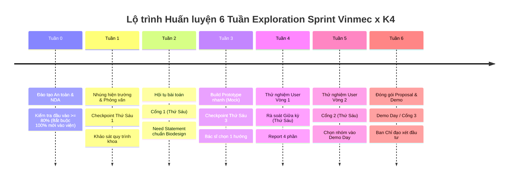

# Kế Hoạch 1 Trang: Dẫn Dắt & Huấn Luyện Nhóm K4 (K4 Coaching Framework)

> **Người thực hiện:** Nguyễn Xuân Tài — Cựu học viên K2 (Lab Coach / Technical Lead)  
> **Vai trò:** K2 Lab Coach / Technical Lead & Forward Deployed Engineer  
> **Quy mô phụ trách:** 1 nhóm từ 5–10 bạn sinh viên Khóa 4 (chia làm 2–3 sub-teams nhỏ)  
> **Mục tiêu tối thượng:** Đảm bảo 100% học viên an toàn đạo đức, đúng tiến độ 6 tuần, vượt qua các Cổng thẩm định của Hội đồng Vinmec và tự tin tỏa sáng tại Demo Day.

---

## 1. Lộ Trình 6 Tuần & Các Mốc Kiểm Soát Then Chốt (Milestones & Gates)

| Tuần | Trọng tâm học viên K4 | Vai trò của Coach (K1–K3) | Sản phẩm nghiệm thu (Deliverables) |
| :--- | :--- | :--- | :--- |
| **Tuần 0** | Hoàn thành đào tạo Vinmec, ký NDA, hiểu quy tắc dữ liệu bệnh viện. | Ôn tập, giải đáp thắc mắc, kiểm tra chéo kiến thức bảo mật; chuẩn bị tâm thế vào viện. | 100% học viên đỗ bài test đầu vào ≥ 80%. |
| **Tuần 1** | Đi thực địa cùng bác sĩ/điều dưỡng; ghi chép quan sát hiện trường. | Đi cùng nhóm trong 2 buổi đầu; hướng dẫn cách ghi chú khách quan, không làm phiền y bác sĩ. | Nhật ký quan sát khoa phòng + Danh sách điểm nghẽn. |
| **Tuần 2** | Hội tụ bài toán, viết Need Statement theo Stanford Biodesign. | **Thử thách gắt gao:** Loại bỏ 100% từ khóa giải pháp công nghệ khỏi Need Statement; chuẩn bị bảo vệ Cổng 1. | **⚑ Cổng 1:** Need Statement được Trưởng khoa phê duyệt. |
| **Tuần 3** | Làm prototype nhanh trên mock data (Streamlit / Figma clickable). | Định hướng kiến trúc tối giản; ngăn nhóm over-engineer; kết nối với bác sĩ lâm sàng để lấy phản hồi sơ bộ. | Prototype chạy được kịch bản cốt lõi trên mock data. |
| **Tuần 4** | Thử nghiệm người dùng vòng 1 (3–5 người Vinmec) + Viết báo cáo. | Giám sát buổi test đầu tiên; hướng dẫn phân tích insight khách quan, không tự bào chữa lỗi thiết kế. | **⚑ Rà soát giữa kỳ:** Báo cáo thử nghiệm 4 phần chuẩn mực. |
| **Tuần 5** | Thử nghiệm vòng 2; hoàn thiện đề xuất giải pháp khả thi. | Huấn luyện kỹ năng thuyết trình, chuẩn bị slide tóm tắt 10 trang; rà soát an toàn AI trước Cổng 2. | **⚑ Cổng 2:** Được chọn vào vòng chung kết Demo Day. |
| **Tuần 6** | Đóng gói mã nguồn, diễn tập Demo Day 10 phút thuyết trình. | Tổ chức 3 buổi Mock Pitching gắt gao; đóng vai Ban Giám khảo phản biện câu hỏi hóc búa. | **⚑ Demo Day / Cổng 3:** Proposal hoàn chỉnh + Live Demo. |

---

## 2. Quy Trình Review Báo Cáo Tuần & Nhịp Làm Việc (Weekly Cadence)

* **Nhịp làm việc cố định hàng tuần:**
  * **Thứ Hai:** Tham gia buổi đào tạo phương pháp của V-RIC cùng nhóm.
  * **Thứ Tư:** Tham gia đào tạo nghiệp vụ bệnh viện của Vinmec; họp nhanh 15 phút giữa tuần giải quyết thắc mắc.
  * **Thứ Sáu 17h00 (Hạn chót thu báo cáo):** Cả nhóm nộp Weekly Report và Báo cáo sau mỗi vòng thử nghiệm người dùng.
  * **Thứ Sáu 19h00 – 20h30 (Checkpoint họp cụm):** Coach chủ trì họp đánh giá tuần, nghiệm thu mốc và giao nhiệm vụ tuần mới.
* **Quy trình phản hồi 3 điểm (P-B-A Feedback Framework):**
  1. **Praise (Khen ngợi nỗ lực cụ thể):** Ghi nhận tiến độ làm việc chăm chỉ và các phát hiện thực tế sắc sảo.
  2. **Bottleneck (Chỉ rõ điểm nghẽn):** Thẳng thắn chỉ ra điểm tài liệu mơ hồ, thiếu bằng chứng hoặc vi phạm ranh giới.
  3. **Action (Hành động sửa đổi):** Giao chính xác 1–2 việc cần vá ngay trong vòng 24 giờ.
* **Chiến lược xử lý trễ hạn (Anti-procrastination Protocol):**
  * Nhắc nhở chủ động trước 4 tiếng (13h00 Thứ Sáu). Nếu sau 17h00 chưa nộp, gọi điện trực tiếp cho Team Lead để nắm lý do và hỗ trợ tháo gỡ khó khăn thay vì chỉ trích.

---

## 3. Chiến Lược Gỡ Rối Khi Nhóm Bế Tắc (Unblocking Strategies)

| Tình huống bế tắc | Dấu hiệu nhận biết | Chiến lược Coach can thiệp ngay lập tức |
| :--- | :--- | :--- |
| **1. Tràn ngập bài toán (Problem Overload)** | Nhóm thấy khoa phòng có hàng chục vấn đề, cãi nhau không biết chọn đề tài nào. | Dùng **Ma trận Impact vs Feasibility**. Buộc nhóm chọn khoảnh khắc hẹp nhất có thể làm xong prototype trong 10 ngày. |
| **2. Bẫy ham công nghệ (Over-engineering Trap)** | Nhóm muốn tự huấn luyện mô hình LLM từ đầu, bàn về kiến trúc microservices phức tạp. | **Kéo về thực tế:** *"Người dùng cần giải quyết điểm đau gì? Hãy làm giao diện Streamlit trong 48 giờ để test trước đã."* |
| **3. Bế tắc tuyển người test (User Recruiting Block)** | Nhóm ngại tiếp cận bác sĩ hoặc người dùng tại sảnh viện. | Coach trực tiếp làm mẫu cuộc phỏng vấn đầu tiên; kết nối với bác sĩ đầu mối Vinmec để sắp xếp khung giờ thuận lợi. |
| **4. Xung đột nội bộ (Team Friction)** | Phân chia công việc không đều, một vài thành viên thụ động hoặc lấn át người khác. | Tổ chức họp 1-on-1 lắng nghe tâm tư; tái cấu trúc vai trò rõ ràng theo năng lực (Product, Tech, Research). |

---

## 4. Bộ Tiêu Chí Kiểm Soát Chất Lượng (Quality Gate Rubric)

Trước khi ký duyệt cho nhóm nộp bài lên Hội đồng Vinmec tại các Cổng, Coach chấm theo thang điểm 4 chuẩn mực:

* [x] **Tiêu chí 1: Tuyệt đối tuân thủ Bảo mật & Đạo đức (Trọng số 30% - Cổng Sinh tử):** 100% không chứa dữ liệu bệnh nhân thật; không chụp ảnh người bệnh; ẩn danh P1–P3; có quy trình chuyển tuyến khẩn cấp.
* [x] **Tiêu chí 2: Chất lượng Need Statement (Trọng số 25%):** Đúng cú pháp Stanford Biodesign; tuyệt đối không đưa công nghệ/giải pháp vào câu tuyên bố; vấn đề được lượng hóa rõ ràng.
* [x] **Tiêu chí 3: Bằng chứng Thực nghiệm Prototype (Trọng số 25%):** Prototype chạy mượt mà, có log kiểm thử với người thật (3–5 người); có số liệu đo lường trước/sau tối ưu hóa.
* [x] **Tiêu chí 4: Kỹ năng Trình bày & Văn hóa Đồng đội (Trọng số 20%):** Slide mạch lạc, súc tích (tối đa 10 slide); tinh thần cầu thị, trung thực và chính trực của người kỹ sư công nghệ vì sức khỏe cộng đồng.

