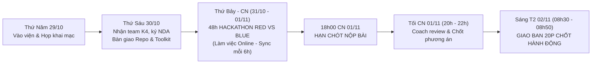
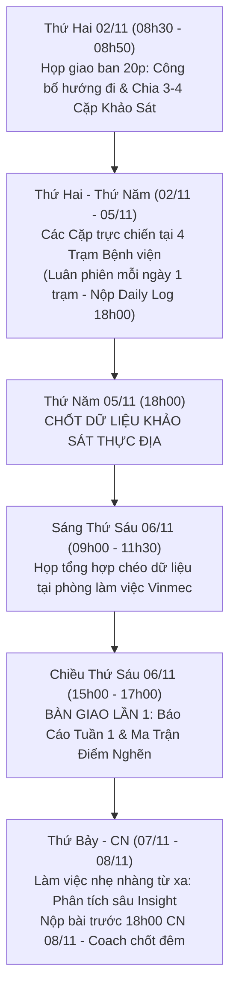
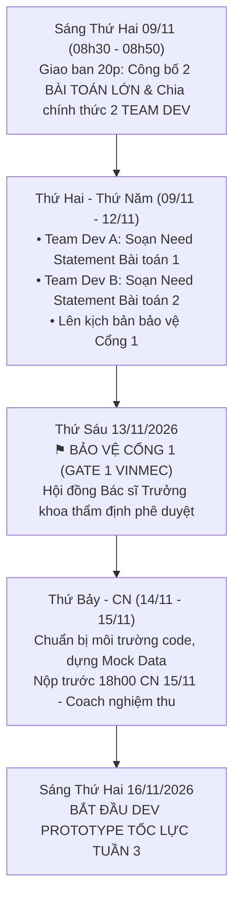

# Kế Hoạch Tác Chiến Chi Tiết Từng Tuần (Weekly Execution Schedule)

> **Dành riêng cho:** Đợt Exploration Sprint 6 Tuần tại Hệ thống Y tế Vinmec x Học viên Khóa 4 (K4)  
> **Người điều phối:** Nguyễn Xuân Tài — K2 Lab Coach / Technical Lead & Forward Deployed Engineer  
> **Nguyên tắc vận hành thép:**  
> 1. **Nhịp giao ban chớp nhoáng (15–20 phút sáng Thứ Hai):** Không ngồi cãi nhau về ý tưởng; chỉ chốt phân công và hành động vì mọi đầu việc đã được chốt từ tối Chủ Nhật.  
> 2. **Kỷ luật cuối tuần (Weekend Cadence):** Không nghỉ hoàn toàn cuối tuần; làm việc nhẹ nhàng từ xa (không cần đến viện). **Hạn chót nộp bài: 18h00 tối Chủ Nhật.** Coach duyệt và chốt bài trong tối Chủ Nhật.  
> 3. **Nhịp chốt thực địa giữa tuần:** Thứ Năm chốt dữ liệu khảo sát; sáng Thứ Sáu tổng hợp chéo; chiều Thứ Sáu bàn giao báo cáo / bảo vệ Cổng với Vinmec.

---

## Bảng Tổng Hợp Tiến Độ & Mốc Thời Gian Thực Tế (Lịch Tháng 10 – 11/2026)

| Giai đoạn | Khung ngày (Thực tế 2026) | Trọng tâm học viên K4 | Nhiệm vụ Coach & Mốc bàn giao then chốt |
| :--- | :--- | :--- | :--- |
| **Tuần 0** | **29/10 – 01/11/2026** | **29–30/10:** Khai mạc, họp đầu, ký NDA. **31/10–01/11:** Hackathon Red vs Blue (Online). | • **18h00 CN 01/11:** Hạn nộp Hackathon. • Tối CN Coach chốt ý tưởng, chuẩn bị phân cặp. |
| **Tuần 1** | **02/11 – 08/11/2026** | **02–05/11:** Khảo sát thực địa theo Cặp (4 trạm). **07–08/11:** Làm sạch data & soạn báo cáo từ xa. | • **08h30 T2 (02/11):** Họp 15p chốt idea & phân cặp. • **T5 (05/11):** Chốt data thực địa. • **Sáng T6 (06/11):** Tổng hợp dữ liệu. • **Chiều T6 (06/11):** Bàn giao Báo cáo Tuần 1. • **18h00 CN 08/11:** Nộp phân tích điểm nghẽn. |
| **Tuần 2** | **09/11 – 15/11/2026** | **09–12/11:** Tái cấu trúc thành 2 Team Dev; viết Need Statement chuẩn Biodesign. **13/11:** Bảo vệ Cổng 1 trước Vinmec. | • **08h30 T2 (09/11):** Họp 15p chia 2 Team Dev. • **T5 (12/11):** Tổng duyệt slide bảo vệ Cổng 1. • **T6 (13/11): ⚑ CỔNG 1 — Duyệt Need Statement.** • **18h00 CN 15/11:** Chốt Mock Data & Kiến trúc. |
| **Tuần 3** | **16/11 – 22/11/2026** | **16/11:** Bắt đầu Dev Prototype tốc lực. Build UI Streamlit/Figma & Prompt Pipeline. | • **08h30 T2 (16/11):** Bắt đầu Sprint Dev 2 dự án. • **T6 (20/11):** Demo nội bộ prototype chạy được. • **18h00 CN 22/11:** Đóng gói bản Alpha sẵn sàng test. |
| **Tuần 4** | **23/11 – 29/11/2026** | Thử nghiệm người dùng Vòng 1 (3–5 người Vinmec). Ghi nhận User Testing Log & Đo lường định lượng. | • **T6 (27/11): ⚑ RÀ SOÁT GIỮA KỲ — Báo cáo 4 phần.** • **18h00 CN 29/11:** Nộp danh mục lỗi & kế hoạch vá. |
| **Tuần 5** | **30/11 – 06/12/2026** | Thử nghiệm Vòng 2; Tối ưu hóa UI/Prompt; Hoàn thiện Proposal thương mại hóa & An toàn AI. | • **T6 (04/12): ⚑ CỔNG 2 — Chọn nhóm vào Chung kết.** • **18h00 CN 06/12:** Nộp Slide Draft 10 trang. |
| **Tuần 6** | **07/12 – 13/12/2026** | Đóng gói mã nguồn Repo, diễn tập Demo Pitching; Bảo vệ trước Ban Chỉ đạo Y tế & Giám đốc Vinmec. | • **T2–T4:** 3 vòng Mock Pitching gắt gao. • **T6 (11/12): ⚑ DEMO DAY / CỔNG 3 — Tỏa sáng.** |

---

## Chi Tiết Kế Hoạch 3 Tuần Khởi Động Then Chốt (Tuần 0, 1, 2)

### TUẦN 0: KICKOFF, BÀN GIAO & HACKATHON ĐỐI KHÁNG (29/10 – 01/11/2026)

* **Thứ Năm (29/10/2026):** 
  - Họp phiên đầu tiên tại Bệnh viện Đa khoa Quốc tế Vinmec.
  - Phổ biến mục tiêu Exploration Sprint và các quy định an toàn bệnh viện.
* **Thứ Sáu (30/10/2026):**
  - Chính thức nhận nhóm học viên K4 (5–10 bạn sinh viên).
  - Hoàn tất ký cam kết bảo mật thông tin (NDA).
  - **Bàn giao tài nguyên:** Bàn giao Repo mẫu K2, sách *The Mom Test*, và [fieldwork-stakeholder-questions.md](./fieldwork-stakeholder-questions.md).
  - Kích hoạt Hackathon 48h Red Team vs Blue Team:
    * **Blue Team:** Tìm cách bảo vệ, mở rộng tính năng và logic của Care Navigator.
    * **Red Team (Devil's Advocate):** Bóc tách rủi ro đạo đức, tìm các bài toán cấp bách hơn tại hiện trường.
* **Thứ Bảy & Chủ Nhật (31/10 – 01/11/2026):**
  - Các nhóm triển khai online, cập nhật repo định kỳ mỗi 6 tiếng.
  - **HẠN CHÓT NỘP BÀI: 18h00 Chủ Nhật 01/11/2026.**
  - **Tối Chủ Nhật (20h00 – 22h00):** Coach K2 đọc repo của 2 bên, đối chiếu lập luận, đưa ra quyết định chốt hướng đi ngay trong đêm.
  - **Mục tiêu:** Không để xung đột ý tưởng dây dưa sang tuần sau.

---

### TUẦN 1: KHẢO SÁT THEO CẶP & BÀN GIAO LẦN 1 (02/11 – 08/11/2026)

* **Sáng Thứ Hai (02/11/2026 - 08h30 đến 08h50):**
  - Họp giao ban vỏn vẹn **20 phút**: Coach công bố kết luận từ Hackathon cuối tuần; không tranh cãi thêm.
  - Phân chia nhóm K4 thành **3–4 Cặp (Pairs)** bám theo [hospital-operations-blueprint.md](./hospital-operations-blueprint.md):
    * *Cặp 1:* Khảo sát Trạm 1 (Tiếp đón, Bấm số & Phân luồng ban đầu).
    * *Cặp 2:* Khảo sát Trạm 2 (Khu Chờ khám & Phòng khám chuyên khoa).
    * *Cặp 3:* Khảo sát Trạm 3 (Khu Cận lâm sàng: Xét nghiệm máu, Chẩn đoán hình ảnh).
    * *Cặp 4 (nếu có):* Khảo sát Trạm 4 (Trả kết quả, Nhà thuốc, Hướng dẫn ra viện).
  - Quy tắc phân vai trong cặp: 1 bạn chủ trì phỏng vấn/tương tác, 1 bạn ghi chép (Scribe) và quan sát cử chỉ vi mô.
* **Thứ Hai đến Thứ Năm (02/11 – 05/11/2026):**
  - Các cặp thực hiện quan sát và phỏng vấn tại các trạm; luân chuyển trạm hàng ngày.
  - Nộp [Daily Field Observation Log](./fieldwork-stakeholder-questions.md#phần-vi-mẫu-nhật-ký-quan-sát-hiện-trường-hàng-ngày-daily-field-observation-log-template) trước **18h00 mỗi ngày**.
  - **MỐC CHỐT DỮ LIỆU: 18h00 Thứ Năm (05/11/2026) khóa sổ toàn bộ dữ liệu đi viện Tuần 1.**
* **Thứ Sáu (06/11/2026 - Ngày Bàn Giao Lần 1):**
  - **Sáng (09h00 – 11h30):** Cả nhóm họp tại phòng làm việc Vinmec, đối chiếu chéo các bản log, lọc ra danh sách điểm nghẽn thực chất (Ground Truth).
  - **Chiều (15h00 – 17h00): BÀN GIAO LẦN 1** — Nộp Báo cáo Tuần 1 lên Quản lý chương trình và Bác sĩ Cố vấn.
* **Thứ Bảy & Chủ Nhật (07/11 – 08/11/2026):**
  - Học viên không cần đến viện. Làm việc nhẹ nhàng từ xa: tổng hợp số liệu đo lường thời gian chờ, trích xuất 5 quote đắt giá nhất.
  - **HẠN CHÓT: 18h00 Chủ Nhật 08/11/2026.**
  - **Tối Chủ Nhật:** Coach chốt ma trận đánh giá năng lực từng thành viên và lên danh sách phân chia 2 Team Dev.

---

### TUẦN 2: CHIA 2 TEAM DEV & BẢO VỆ CỔNG 1 (09/11 – 15/11/2026)

* **Sáng Thứ Hai (09/11/2026 - 08h30 đến 08h50):**
  - Họp giao ban **20 phút**: Coach công bố **2 Bài toán cốt lõi** được chắt lọc từ kết quả khảo sát Tuần 1.
  - **Chia nhóm chính thức thành 2 TEAM DEV (Sub-team A và Sub-team B):**
    * *Team Dev A (4–5 bạn):* Chuyên trách Bài toán 1 (ví dụ: Hỗ trợ giải thích kết quả cận lâm sàng & Định hướng khám tiếp theo).
    * *Team Dev B (4–5 bạn):* Chuyên trách Bài toán 2 (ví dụ: Điều hướng trạm khám thời gian thực - Live Wayfinding & Giảm tải chờ đợi).
    * Mỗi team phân công rõ: 1 Team Lead (sở hữu Need Statement), 2 Dev (UI/Prompt), 1 Data/Validation.
* **Thứ Hai đến Thứ Năm (09/11 – 12/11/2026):**
  - Hai team hoàn thiện câu Need Statement chuẩn Stanford Biodesign (loại bỏ 100% từ khóa giải pháp công nghệ).
  - Thu thập thêm các tài liệu, chỉ số y khoa phục vụ cho bài bảo vệ.
  - Chiều Thứ Năm (12/11): Diễn tập thử bảo vệ Cổng 1 trước Coach K2.
* **Thứ Sáu (13/11/2026 - MỐC SINH TỬ CỔNG 1):**
  - **⚑ BẢO VỆ CỔNG 1 (GATE 1):** Hai Team Dev lần lượt trình bày Need Statement và phân tích điểm nghẽn trước Hội đồng Bác sĩ Trưởng khoa và Ban Quản lý Vinmec.
  - Mục tiêu: Được phê duyệt 100% để bước vào giai đoạn chế tạo giải pháp.
* **Thứ Bảy & Chủ Nhật (14/11 – 15/11/2026):**
  - Hoạt động từ xa: Thiết lập repository nhánh, cấu trúc thư mục code, chuẩn bị Mock Data sạch (không danh tính thật).
  - **HẠN CHÓT: 18h00 Chủ Nhật 15/11/2026.**
  - **Tối Chủ Nhật:** Coach review repo setup.
* **Thứ Hai (16/11/2026):**
  - Bắt đầu Tuần 3: 2 Team Dev chính thức bắt tay viết code prototype và prompt pipeline tốc lực!
