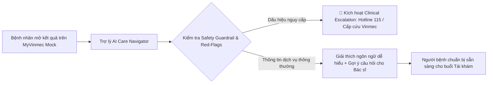

# Vinmec x VRIC Exploration Sprint (6 Tuần) — Bài Tập Ứng Tuyển K1–K3

> **Dự án:** Một lần đi khám: Thiết kế lại trải nghiệm người bệnh với AI trên ứng dụng MyVinmec  
> **Ứng viên:** Nguyễn Xuân Tài — Cựu học viên K2 (Lab Coach / Technical Lead)  
> **Hạn nộp:** 23h59 Thứ Hai, 19/10/2026  
> **Kênh nộp bài:** Gửi link repo qua email tới `anh.ntm2@vinuni.edu.vn` với tiêu đề `[Exploration Sprint] Bài tập 1 tuần – Nguyễn Xuân Tài – K2`

---

## 1. Tổng Quan & Bối Cảnh Bài Toán

VinUni VRIC – Vinmec Exploration Sprint là chương trình 6 tuần đưa các kỹ sư và Product Lead nhúng trực tiếp vào môi trường bệnh viện thực tế của Hệ thống Y tế Vinmec. Với vai trò kép:
1. **Forward Deployed Engineer / Product Specialist:** Cùng đội ngũ y bác sĩ, điều dưỡng và nhân sự vận hành quan sát hiện trường, phát hiện điểm đau dịch vụ, xây dựng Need Statement chuẩn Stanford Biodesign và kiểm chứng prototype AI nhanh.
2. **Coach / Technical Lead dẫn dắt nhóm K4 (5–10 học viên):** Giữ nhịp độ mốc sprint (Checkpoint thứ Sáu, Cổng 1, Rà soát giữa kỳ, Cổng 2, Demo Day), review báo cáo, gỡ rối (unblock) kỹ thuật và kiểm soát chất lượng đầu ra.

### Khoảnh khắc lựa chọn đào sâu (Moment of Truth):
* **Khoảnh khắc:** **Nhận và Đọc hiểu Kết quả Cận lâm sàng / Hướng dẫn Tái khám trên ứng dụng MyVinmec**.
* **Lý do lựa chọn:** Đây là điểm giao thoa có mức độ lo âu tâm lý (anxiety curve) cao nhất của người bệnh. Sau khi rời phòng khám/xét nghiệm, người bệnh đối mặt với các bản kết quả số học phức tạp, thuật ngữ y khoa khó hiểu trên app MyVinmec trong khi bác sĩ không thể túc trực 24/7 để giải thích từng chỉ số hành chính thông thường.

---

## 2. Mục Lục Điều Hướng Repository

Toàn bộ tài liệu, bằng chứng nghiên cứu và mã nguồn được cấu trúc theo chuẩn quy chuẩn nộp bài:

| Thư mục / File | Mô tả nội dung chi tiết | Liên kết nhanh |
| :--- | :--- | :--- |
| `01-phong-van/` | Ghi chép dùng thử MyVinmec (Bạn làm gì – Thấy gì – Vướng ở đâu), Interview Guide, biên bản phỏng vấn 3 người dùng (P1–P3 theo quy chế bảo mật), tổng hợp Insight & **Bộ công cụ câu hỏi thực địa chuẩn bị cho Sprint 6 tuần (Fieldwork Question Bank để K1–K3 coach K4 khi Onboard vào viện)**. | [Dùng thử MyVinmec](./01-phong-van/myvinmec-heuristic-audit.md) · [Interview Guide](./01-phong-van/interview-guide.md) · [Nhật ký P1–P3](./01-phong-van/interview-notes.md) · [Ngân hàng câu hỏi 6 tuần](./01-phong-van/fieldwork-stakeholder-questions.md) |
| `02-journey-map/` | Bản đồ hành trình (Workflow Journey Map) và ma trận phân tích điểm đau (Pain points analysis). | [Xem 02-journey-map](./02-journey-map/workflow-journey-map.md) |
| `03-need-statement/` | Tuyên bố nhu cầu chuẩn Stanford Biodesign (không chứa công nghệ/giải pháp). | [Xem 03-need-statement](./03-need-statement/need-statement.md) |
| `04-best-practice/` | Nghiên cứu 3 mô hình quốc tế (Mayo Clinic, Cleveland Clinic/MyChart, Ada Health/NHS) & bài học cho Vinmec. | [Xem 04-best-practice](./04-best-practice/international-benchmarks.md) |
| `05-prototype/` | Mã nguồn/thiết kế prototype AI: **Giao diện điện thoại MyVinmec độc lập ([Xem trực tiếp index.html](./05-prototype/index.html))**, script **1-click [start.bat](./05-prototype/start.bat)**, bản Streamlit (`app.py`), System Instructions và User Testing Logs. | [Xem trực tiếp Prototype](./05-prototype/index.html) · [Hướng dẫn kỹ thuật](./05-prototype/README.md) |
| `06-rui-ro-dao-duc/` | Phân tích rủi ro an toàn thông tin (Nghị định 13/2023/NĐ-CP, HIPAA), Ảo giác AI và Quy trình chuyển tuyến khẩn cấp. | [Xem 06-rui-ro-dao-duc](./06-rui-ro-dao-duc/safety-and-privacy-risks.md) |
| `07-coach-plan/` | Bản kế hoạch 1 trang dẫn dắt nhóm K4: Lịch trình các cổng, quy trình review tuần, chiến lược gỡ rối và Quality Gate. | [Xem 07-coach-plan](./07-coach-plan/k4-coaching-framework.md) |
| `slides.pdf` (hoặc `slides/`) | **Bản thuyết trình chính thức (chuẩn 10 slide theo Mục 6.0 & 6.3)**: Tóm tắt toàn bài dùng cho buổi present 10 phút trước Hội đồng Tuyển chọn Vinmec. | **[Tải file slides.pdf](./slides.pdf)** · [Xem đề cương outline](./slides/slides-outline.md) · [Bản trình chiếu HTML](./slides/presentation.html) |

---

## 3. Tóm Tắt Giải Pháp AI Prototype

Giải pháp tập trung vào **"MyVinmec Plain-Language Care Navigator"** — Trợ lý thông tin dịch vụ và giải thích kết quả cận lâm sàng dạng ngôn ngữ bình dân có rào chắn bảo vệ y tế:
* **Không đưa ra chẩn đoán y khoa:** Chỉ giải thích ngữ nghĩa thông thường của các thuật ngữ xét nghiệm, so sánh chỉ số với khoảng tham chiếu tiêu chuẩn được mock, và gợi ý các câu hỏi người bệnh nên trao đổi với bác sĩ trong buổi tái khám.
* **Escalation Protocol tự động:** Tự động phát hiện các từ khóa nguy kịch (Red Flag Symptoms) và lập tức cung cấp số hotline cấp cứu Vinmec / 115 cùng hướng dẫn tới phòng Cấp cứu gần nhất.
* **Tech Stack Prototype:**
  * **Frontend:** Streamlit / Web UI tương tác mô phỏng giao diện MyVinmec.
  * **LLM Engine:** Gemini 1.5 Flash / Claude 3.5 Sonnet với System Prompt có Guardrail nghiêm ngặt.
  * **Synthetic Mock Data:** Bộ dữ liệu xét nghiệm máu/nước tiểu giả lập 100%, không chứa bất kỳ thông tin bệnh nhân thật nào.

---

## 4. Công Bố Mức Độ Hỗ Trợ Từ AI (AI Transparency Disclosure)

Tuân thủ nghiêm ngặt quy định tại Mục 6.4 & 142 của tài liệu hướng dẫn bài tập, mức độ phân định trách nhiệm và ứng dụng AI trong bài nộp được minh bạch như sau:

| Hạng mục nội dung | Mức độ hỗ trợ từ AI | Vai trò thực hiện của ứng viên |
| :--- | :--- | :--- |
| **01. Phỏng vấn & Thử nghiệm app** | **0% AI** | Ứng viên **trực tiếp** cài đặt/dùng thử MyVinmec, soạn câu hỏi, thực hiện 3 cuộc phỏng vấn người thật (P1, P2, P3) và ghi chép transcript. |
| **02. Journey Map & Pain Points** | **15% AI** (AI hỗ trợ gợi ý format Markdown) | Ứng viên trực tiếp tổng hợp cảm xúc, xác định điểm đau thực tế từ ghi chép phỏng vấn và sắp xếp thứ tự ưu tiên. |
| **03. Need Statement** | **20% AI** (AI hỗ trợ rà soát từ ngữ giải pháp) | Ứng viên chọn lọc vấn đề, viết và lọc bỏ hoàn toàn các yếu tố công nghệ theo chuẩn Stanford Biodesign. |
| **04. Best Practice Quốc tế** | **40% AI** (AI hỗ trợ tổng hợp tư liệu thô) | Ứng viên kiểm chứng nguồn gốc trích dẫn (Mayo, Cleveland, NHS), phân tích tính khả thi và điều chỉnh phù hợp với bối cảnh Vinmec tại Việt Nam. |
| **05. Prototype & Testing** | **35% AI** (AI hỗ trợ viết mã UI boilerplate) | Ứng viên thiết kế System Prompt, thiết lập Guardrails an toàn, trực tiếp mời 2–3 người dùng test tương tác và ghi nhận log phản hồi thực tế. |
| **06. Rủi ro & Đạo đức** | **25% AI** (AI hỗ trợ tra cứu điều khoản luật) | Ứng viên đối chiếu Nghị định 13/2023/NĐ-CP, HIPAA và trực tiếp xây dựng quy trình chuyển tuyến khẩn cấp phù hợp quy chế y tế. |
| **07. Coach Plan K4** | **10% AI** (AI hỗ trợ căn chỉnh bố cục 1 trang) | Ứng viên đúc kết 100% từ kinh nghiệm làm Lab Coach / Team Lead các khóa trước để thiết lập khung hỗ trợ nhóm K4 thực chiến. |
| **Slides Deck** | **20% AI** (AI hỗ trợ dàn ý tóm tắt) | Ứng viên biên soạn nội dung, chọn lọc thông điệp và thiết kế bản thuyết trình 10 slide. |

---

## 5. Cam Kết An Toàn & Đạo Đức Y Tế

1. **Bảo mật và Quyền riêng tư:** Tuyệt đối không thu thập, lưu trữ hay xử lý dữ liệu bệnh án thật. Mọi thông tin người tham gia được ẩn danh hóa nghiêm ngặt (`P1`, `P2`, `P3`). Không lưu trữ hình ảnh cá nhân hay giấy tờ viện phí.
2. **Ranh giới Phi lâm sàng (Non-clinical Boundary):** Phỏng vấn và giải pháp chỉ xoay quanh trải nghiệm dịch vụ, luồng di chuyển, tương tác ứng dụng số; không hỏi và không can thiệp vào chẩn đoán hay điều trị y khoa.
3. **Tuân thủ quy chế:** Sẵn sàng ký NDA và hoàn thành đầy đủ các khóa đào tạo bắt buộc của Vinmec trước khi chính thức vào bệnh viện làm việc thực tế tại Tuần 0.
